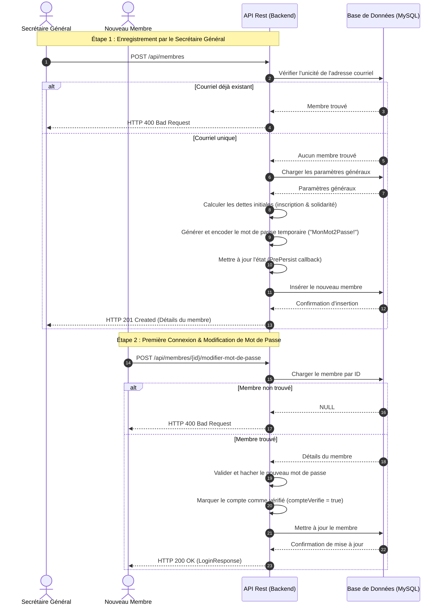
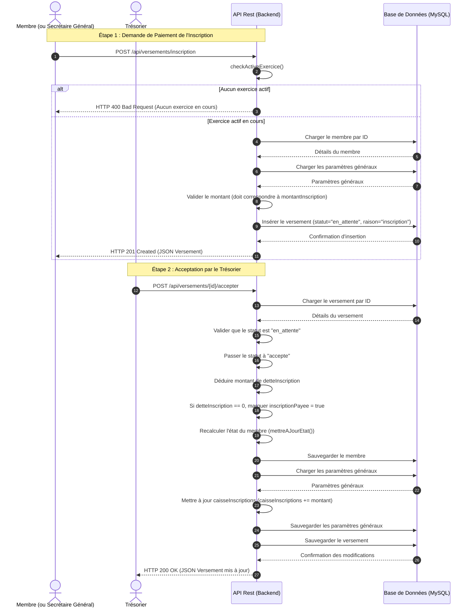
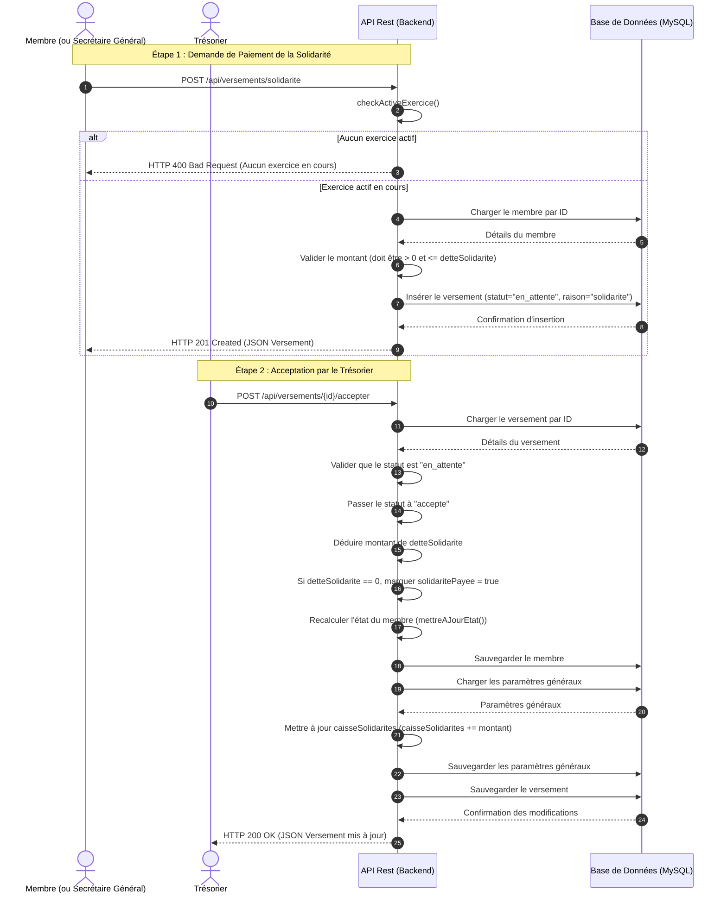
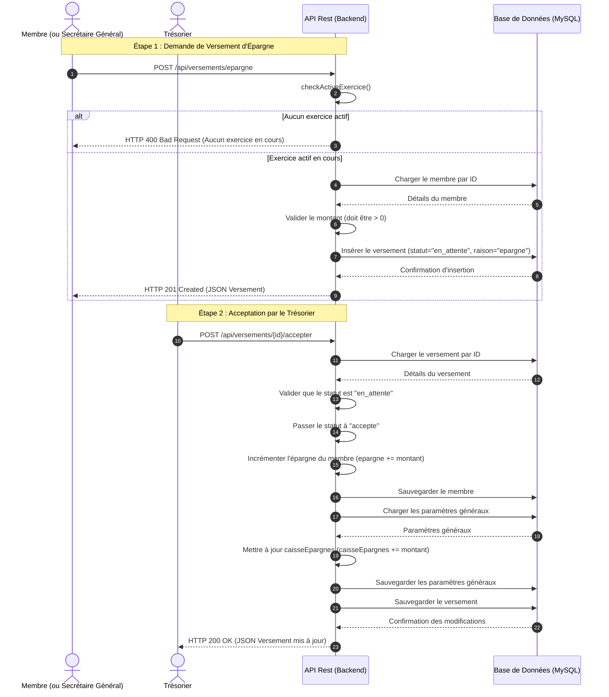
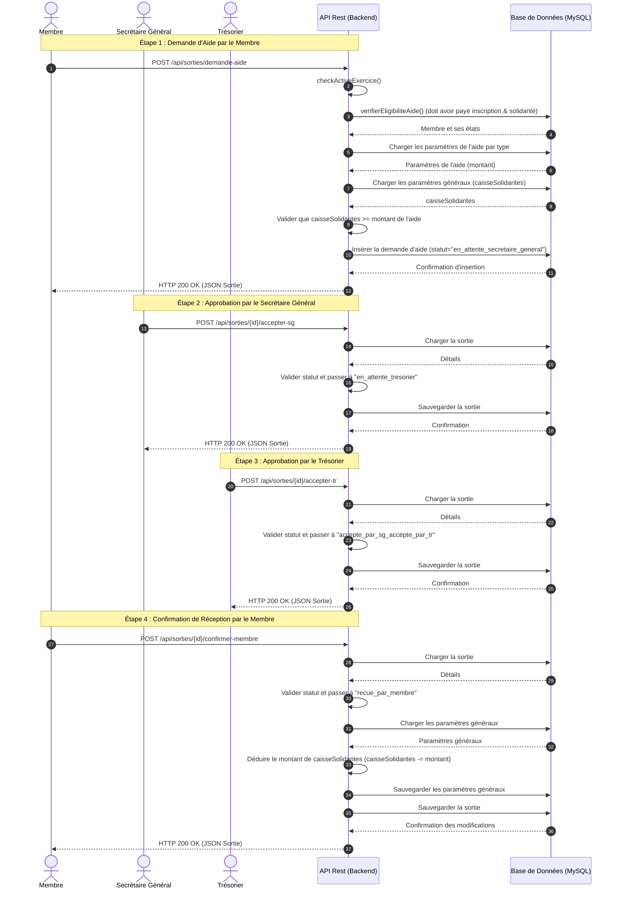
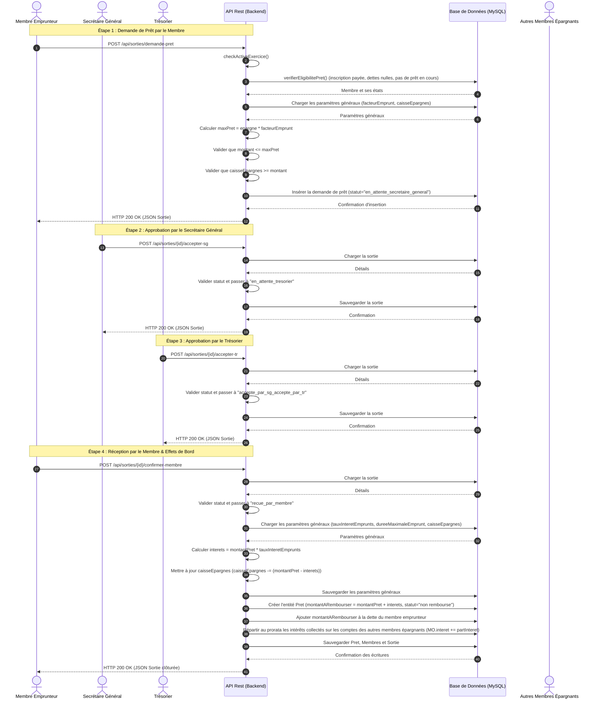
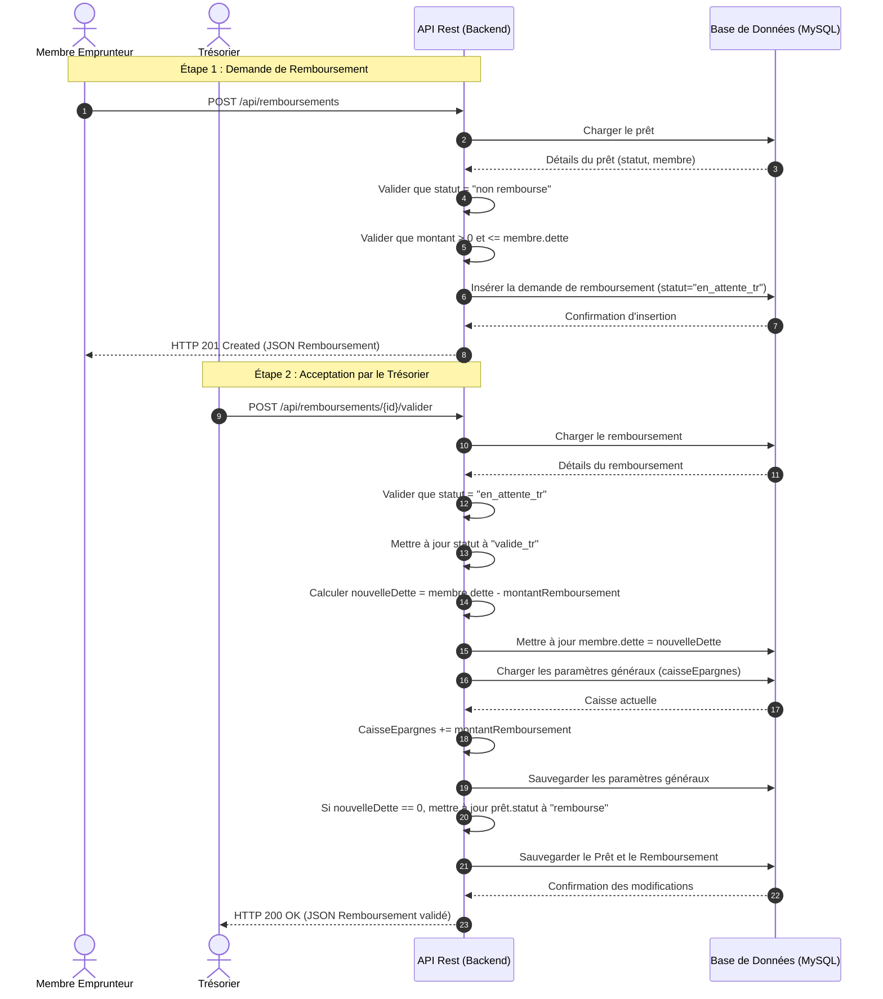
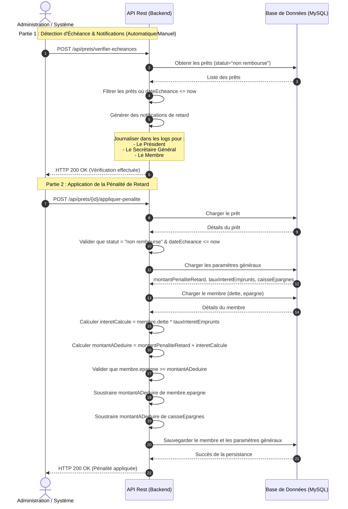

# Scénarios Mutuelle : Création, Activation et Paiement de l'Inscription

Ce document regroupe les descriptions détaillées des scénarios majeurs du système.

## Table des Matières
1. [Scénario de Création et d'Activation d'un Membre](#scénario-de-création-et-dactivation-dun-membre)
   * [Étape 1 : Enregistrement par le Secrétaire Général](#étape-1--enregistrement-par-le-secrétaire-général)
   * [Étape 2 : Première Connexion et Modification du Mot de Passe](#étape-2--première-connexion-et-modification-du-mot-de-passe)
2. [Scénario Complet de Paiement de l'Inscription](#scénario-complet-de-paiement-de-linscription)
   * [Étape 1 : Demande de Paiement de l'Inscription](#étape-1--demande-de-paiement-de-linscription)
   * [Étape 2 : Acceptation par le Trésorier](#étape-2--acceptation-par-le-trésorier)
3. [Scénario Complet de Versement de la Solidarité](#scénario-complet-de-versement-de-la-solidarité)
   * [Étape 1 : Demande de Paiement de la Solidarité](#étape-1--demande-de-paiement-de-la-solidarité)
   * [Étape 2 : Acceptation par le Trésorier](#étape-2--acceptation-par-le-trésorier-1)
4. [Scénario Complet de Versement de l'Épargne](#scénario-complet-de-versement-de-lépargne)
   * [Étape 1 : Demande de Versement d'Épargne](#étape-1--demande-de-versement-dépargne)
   * [Étape 2 : Acceptation par le Trésorier](#étape-2--acceptation-par-le-trésorier-2)
5. [Scénario Complet de Demande d'Aide Financière](#scénario-complet-de-demande-daide-financière)
   * [Étape 1 : Demande d'Aide par le Membre](#étape-1--demande-daide-par-le-membre)
   * [Étape 2 : Validation par le Secrétaire Général](#étape-2--validation-par-le-secrétaire-général)
   * [Étape 3 : Validation par le Trésorier](#étape-3--validation-par-le-trésorier)
   * [Étape 4 : Confirmation de Réception par le Membre](#étape-4--confirmation-de-réception-par-le-membre)
6. [Scénario Complet de Demande d'Emprunt / Prêt](#scénario-complet-de-demande-demprunt--prêt)
   * [Étape 1 : Demande de Prêt par le Membre](#étape-1--demande-de-prêt-par-le-membre)
   * [Étape 2 : Validation par le Secrétaire Général](#étape-2--validation-par-le-secrétaire-général-1)
   * [Étape 3 : Validation par le Trésorier](#étape-3--validation-par-le-trésorier-1)
   * [Étape 4 : Confirmation de Réception par le Membre et Effets de Bord Comptables](#étape-4--confirmation-de-réception-par-le-membre-et-effets-de-bord-comptables)
7. [Scénario Complet de Remboursement d'un Prêt](#scénario-complet-de-remboursement-dun-prêt)
   * [Étape 1 : Demande de Remboursement par le Membre](#étape-1--demande-de-remboursement-par-le-membre)
   * [Étape 2 : Acceptation par le Trésorier](#étape-2--acceptation-par-le-trésorier-3)
8. [Scénario d'Échéance de Prêt et d'Application de Pénalité](#scénario-déchéance-de-prêt-et-dapplication-de-pénalité)
   * [1. Vérification des Échéances et Notification](#1-vérification-des-échéances-et-notification)
   * [2. Application de la Pénalité de Retard](#2-application-de-la-pénalité-de-retard)

---

## Scénario de Création et d'Activation d'un Membre




---

## Étape 1 : Enregistrement par le Secrétaire Général

Cette étape permet au Secrétaire Général de pré-enregistrer un nouveau membre dans le système. Le membre n'a pas encore accès à son compte personnel à ce stade.

### 1. Endpoint
* **Méthode** : `POST`
* **URL** : `/api/membres`

### 2. Payload d'entrée (JSON)

```json
{
  "nom": "Kengne",
  "prenom": "Gaston",
  "couriel": "gaston.kengne@univ-yaounde1.cm",
  "telephone": "+237677111222",
  "photo": "gaston.png",
  "inscriptionPayee": false
}
```

> [!NOTE]
> Le champ `photo` doit avoir une extension valide (`.jpg`, `.jpeg` ou `.png`). Le champ `inscriptionPayee` est optionnel et vaut `false` par défaut s'il n'est pas fourni.

### 3. Réponses JSON (Sortie)

#### Cas A : Succès (HTTP 201 Created)
Retourne l'entité membre créée avec ses valeurs par défaut calculées.

```json
{
  "id": "6ef226c4-1e76-4f47-8fc5-b2632be3dd80",
  "nom": "Kengne",
  "prenom": "Gaston",
  "couriel": "gaston.kengne@univ-yaounde1.cm",
  "telephone": "+237677111222",
  "photo": "gaston.png",
  "compteVerifie": false,
  "inscriptionPayee": false,
  "solidaritePayee": false,
  "detteSolidarite": 150000.00,
  "detteInscription": 50000.00,
  "epargne": 0.00,
  "interet": 0.00,
  "dette": 0.00,
  "etat": "non a jour",
  "dateCreation": "2026-07-21T11:53:52",
  "dateDerniereConnexion": "2026-07-21T11:53:52"
}
```

#### Cas B : Validation ou Contrainte Violée (HTTP 400 Bad Request)
Par exemple, si l'email existe déjà ou est mal formaté.

```json
{
  "success": false,
  "message": "Un membre avec l'adresse courriel gaston.kengne@univ-yaounde1.cm existe déjà",
  "data": null
}
```

### 4. Effets de bord internes
1. **Unicité de l'email** : Une requête SQL est exécutée pour vérifier si un membre possède déjà l'adresse courriel fournie. Si c'est le cas, l'opération est avortée.
2. **Chargement des paramètres généraux** : Le système consulte la table `parametres_generaux` pour récupérer les montants d'inscription et de solidarité par défaut (`montantInscription` et `montantSolidarite`).
3. **Calcul des dettes initiales** :
   * Si `inscriptionPayee` est `true`, `detteInscription` est initialisée à `0.00`. Sinon, elle prend la valeur de `montantInscription` des paramètres généraux.
   * La `detteSolidarite` est initialisée à la valeur de `montantSolidarite` des paramètres généraux.
   * `solidaritePayee` est initialisé à `false`.
4. **Calcul de l'état** : Via le callback `@PrePersist` de JPA, la méthode `mettreAJourEtat()` classe le membre dans l'un des états suivants selon sa dette de solidarité :
   * `Inactif` (si `detteSolidarite >= 250000`)
   * `non a jour` (si `0 < detteSolidarite < 250000`)
   * `a jour` (si `detteSolidarite == 0`)
5. **Génération du mot de passe par défaut** : Un mot de passe temporaire par défaut (`MonMot2Passe!`) est généré. Il est chiffré (haché) via le service de mot de passe (`BCrypt`) avant d'être persisté.
6. **Journalisation** : Le système produit un log d'information affichant les identifiants générés.

---

## Étape 2 : Première Connexion et Modification du Mot de Passe

Une fois que le membre a reçu ses identifiants temporaires, il doit se connecter pour la première fois et obligatoirement changer son mot de passe pour activer définitivement son compte.

### 1. Endpoint
* **Méthode** : `POST`
* **URL** : `/api/membres/{id}/modifier-mot-de-passe`

### 2. Payload d'entrée (JSON)

```json
{
  "nouveauMotDePasse": "MonNouveauMotDePasseSécurisé123!"
}
```

### 3. Réponses JSON (Sortie)

#### Cas A : Succès (HTTP 200 OK)
Retourne un objet de confirmation contenant les détails du membre mis à jour.

```json
{
  "success": true,
  "message": "Mot de passe modifié avec succès. Votre compte est maintenant vérifié.",
  "data": {
    "id": "6ef226c4-1e76-4f47-8fc5-b2632be3dd80",
    "nom": "Kengne",
    "prenom": "Gaston",
    "couriel": "gaston.kengne@univ-yaounde1.cm",
    "telephone": "+237677111222",
    "photo": "gaston.png",
    "compteVerifie": true,
    "inscriptionPayee": false,
    "solidaritePayee": false,
    "detteSolidarite": 150000.00,
    "detteInscription": 50000.00,
    "epargne": 0.00,
    "interet": 0.00,
    "dette": 0.00,
    "etat": "non a jour",
    "dateCreation": "2026-07-21T11:53:52",
    "dateDerniereConnexion": "2026-07-21T11:55:10"
  }
}
```

#### Cas B : Validation ou Membre inexistant (HTTP 400 Bad Request)

```json
{
  "success": false,
  "message": "Le nouveau mot de passe ne peut pas être vide",
  "data": null
}
```

### 4. Effets de bord internes
1. **Validation de l'existence** : L'API vérifie si l'ID passé dans l'URL correspond à un membre enregistré.
2. **Encodage du mot de passe** : Le nouveau mot de passe est validé (non vide) et encrypté à l'aide de l'algorithme de hachage fort (`BCrypt`).
3. **Mise à jour du statut de vérification** : Le booléen `compteVerifie` est passé à `true`. Cela débloque l'accès aux opérations de la plateforme pour ce membre.
4. **Mise à jour temporelle** : Le champ `dateDerniereConnexion` est automatiquement rafraîchi via le callback `@UpdateTimestamp`.

---

# Scénario Complet de Paiement de l'Inscription

Ce scénario décrit le flux d'enregistrement et d'acceptation du versement requis pour le paiement des frais d'inscription d'un membre.



---

## Étape 1 : Demande de Paiement de l'Inscription

Le membre (ou le Secrétaire Général pour son compte) soumet une intention de versement pour régulariser son inscription à la mutuelle.

### 1. Endpoint
* **Méthode** : `POST`
* **URL** : `/api/versements/inscription`

### 2. Payload d'entrée (JSON)

```json
{
  "membreId": "6ef226c4-1e76-4f47-8fc5-b2632be3dd80",
  "montant": 50000.00
}
```

### 3. Réponses JSON (Sortie)

#### Cas A : Succès (HTTP 201 Created)
Retourne l'entité versement créée avec le statut initial `en_attente`.

```json
{
  "id": "e5e5e5e5-5555-5555-5555-555555555555",
  "montant": 50000.00,
  "dateVersement": "2026-07-21T11:59:15",
  "membre": {
    "id": "6ef226c4-1e76-4f47-8fc5-b2632be3dd80",
    "nom": "Kengne",
    "prenom": "Gaston",
    "couriel": "gaston.kengne@univ-yaounde1.cm",
    "telephone": "+237677111222",
    "compteVerifie": true,
    "inscriptionPayee": false,
    "solidaritePayee": false,
    "detteSolidarite": 150000.00,
    "detteInscription": 50000.00,
    "etat": "non a jour"
  },
  "raison": "inscription",
  "statut": "en_attente",
  "description": "Paiement de l'inscription"
}
```

#### Cas B : Erreur - Pas d'exercice actif (HTTP 400 Bad Request)

```json
{
  "success": false,
  "message": "Aucun exercice en cours. Opération impossible.",
  "data": null
}
```

#### Cas C : Erreur - Montant incorrect (HTTP 400 Bad Request)
Si le montant ne correspond pas exactement aux frais d'inscription en vigueur définis dans les paramètres généraux (ex: 55000 au lieu de 50000).

```json
{
  "success": false,
  "message": "Le montant reçu ne correspond pas au montant de l'inscription (50000.00)",
  "data": null
}
```

### 4. Effets de bord internes
1. **Contrôle d'exercice** : Le système s'assure qu'un exercice comptable possède le statut `en cours`. Sinon, une `IllegalStateException` est levée.
2. **Vérification du membre** : L'API vérifie l'existence du membre via son identifiant unique.
3. **Validation du montant** : Le montant du paiement doit être rigoureusement égal à la valeur de `montantInscription` configurée dans `parametres_generaux`.
4. **Persistance initiale** : Le versement est enregistré dans la table `versements` avec la raison `inscription` et le statut `en_attente`. Un log de notification destiné au trésorier est produit.

---

## Étape 2 : Acceptation par le Trésorier

Une fois le versement physiquement reçu (par espèces ou transfert bancaire), le trésorier valide l'action dans le système.

### 1. Endpoint
* **Méthode** : `POST`
* **URL** : `/api/versements/{id}/accepter`

### 2. Payload d'entrée (JSON)
Aucun corps de requête (request body) requis. L'ID du versement est passé directement en variable de chemin (path variable).

### 3. Réponses JSON (Sortie)

#### Cas A : Succès (HTTP 200 OK)
Retourne le versement avec le statut `accepte` et met en relief la mise à jour des informations de compte du membre (dette résorbée, `inscriptionPayee` mis à `true`).

```json
{
  "id": "e5e5e5e5-5555-5555-5555-555555555555",
  "montant": 50000.00,
  "dateVersement": "2026-07-21T11:59:15",
  "membre": {
    "id": "6ef226c4-1e76-4f47-8fc5-b2632be3dd80",
    "nom": "Kengne",
    "prenom": "Gaston",
    "couriel": "gaston.kengne@univ-yaounde1.cm",
    "telephone": "+237677111222",
    "compteVerifie": true,
    "inscriptionPayee": true,
    "solidaritePayee": false,
    "detteSolidarite": 150000.00,
    "detteInscription": 0.00,
    "etat": "non a jour"
  },
  "raison": "inscription",
  "statut": "accepte",
  "description": "Paiement de l'inscription"
}
```

### 4. Effets de bord internes
1. **Contrôle d'état du versement** : Le versement doit impérativement avoir le statut `en_attente`. Dans le cas contraire, une `IllegalStateException` est levée.
2. **Mise à jour du statut** : Le statut du versement passe à `accepte`.
3. **Mise à jour financière du membre** :
   * La `detteInscription` du membre est soustraite du montant du versement (`detteInscription = detteInscription - montant`). Si le résultat est inférieur ou égal à 0, le champ est forcé à `0.00` et `inscriptionPayee` passe à `true`.
4. **Mise à jour de la caisse générale** : Le montant du versement est directement ajouté au champ `caisseInscriptions` de la table `parametres_generaux`.
5. **Mise à jour de l'état** : L'état global du membre (`etat`) est ré-évalué et mis à jour en base de données.
6. **Journalisation** : Un log de notification d'acceptation du versement est enregistré à destination du trésorier.

---

# Scénario Complet de Versement de la Solidarité

Ce scénario décrit le flux d'enregistrement et d'acceptation du versement requis pour le paiement des frais de solidarité d'un membre.



---

## Étape 1 : Demande de Paiement de la Solidarité

Le membre (ou le Secrétaire Général pour son compte) soumet une intention de versement pour régulariser sa dette de solidarité.

### 1. Endpoint
* **Méthode** : `POST`
* **URL** : `/api/versements/solidarite`

### 2. Payload d'entrée (JSON)

```json
{
  "membreId": "6ef226c4-1e76-4f47-8fc5-b2632be3dd80",
  "montant": 100000.00
}
```

### 3. Réponses JSON (Sortie)

#### Cas A : Succès (HTTP 201 Created)
Retourne l'entité versement créée avec le statut initial `en_attente`.

```json
{
  "id": "f6f6f6f6-6666-6666-6666-666666666666",
  "montant": 100000.00,
  "dateVersement": "2026-07-21T12:15:20",
  "membre": {
    "id": "6ef226c4-1e76-4f47-8fc5-b2632be3dd80",
    "nom": "Kengne",
    "prenom": "Gaston",
    "couriel": "gaston.kengne@univ-yaounde1.cm",
    "telephone": "+237677111222",
    "compteVerifie": true,
    "inscriptionPayee": true,
    "solidaritePayee": false,
    "detteSolidarite": 150000.00,
    "detteInscription": 0.00,
    "etat": "non a jour"
  },
  "raison": "solidarite",
  "statut": "en_attente",
  "description": "Paiement de la solidarité"
}
```

#### Cas B : Erreur - Pas d'exercice actif (HTTP 400 Bad Request)

```json
{
  "success": false,
  "message": "Aucun exercice en cours. Opération impossible.",
  "data": null
}
```

#### Cas C : Erreur - Montant négatif ou nul (HTTP 400 Bad Request)

```json
{
  "success": false,
  "message": "Le montant doit être supérieur à zéro",
  "data": null
}
```

#### Cas D : Erreur - Montant dépasse la dette de solidarité (HTTP 400 Bad Request)

```json
{
  "success": false,
  "message": "Le montant du versement (200000.00) dépasse la dette de solidarité actuelle (150000.00)",
  "data": null
}
```

### 4. Effets de bord internes
1. **Contrôle d'exercice** : Le système s'assure qu'un exercice comptable possède le statut `en cours`. Sinon, une `IllegalStateException` est levée.
2. **Vérification du membre** : L'API vérifie l'existence du membre via son identifiant unique.
3. **Validation du montant** : Le montant du paiement doit être strictement supérieur à 0 et inférieur ou égal à la dette de solidarité restante du membre (`detteSolidarite`).
4. **Persistance initiale** : Le versement est enregistré dans la table `versements` avec la raison `solidarite` et le statut `en_attente`. Un log de notification destiné au trésorier est produit.

---

## Étape 2 : Acceptation par le Trésorier

Le trésorier valide le versement après avoir reçu les fonds.

### 1. Endpoint
* **Méthode** : `POST`
* **URL** : `/api/versements/{id}/accepter`

### 2. Payload d'entrée (JSON)
Aucun corps de requête (request body) requis. L'ID du versement est passé en variable de chemin (path variable).

### 3. Réponses JSON (Sortie)

#### Cas A : Succès (HTTP 200 OK)
Retourne le versement avec le statut `accepte` et reflète la mise à jour des informations de compte du membre (dette restante à 50 000, état toujours "non a jour" car dette > 0).

```json
{
  "id": "f6f6f6f6-6666-6666-6666-666666666666",
  "montant": 100000.00,
  "dateVersement": "2026-07-21T12:15:20",
  "membre": {
    "id": "6ef226c4-1e76-4f47-8fc5-b2632be3dd80",
    "nom": "Kengne",
    "prenom": "Gaston",
    "couriel": "gaston.kengne@univ-yaounde1.cm",
    "telephone": "+237677111222",
    "compteVerifie": true,
    "inscriptionPayee": true,
    "solidaritePayee": false,
    "detteSolidarite": 50000.00,
    "detteInscription": 0.00,
    "etat": "non a jour"
  },
  "raison": "solidarite",
  "statut": "accepte",
  "description": "Paiement de la solidarité"
}
```

#### Cas B : Succès - Solde de la dette de solidarité (HTTP 200 OK)
Si le montant versé correspond exactement à la dette de solidarité restante (50 000 dans notre exemple), le statut du membre passera à `"a jour"`.

```json
{
  "id": "f6f6f6f6-6666-6666-6666-666666666666",
  "montant": 50000.00,
  "dateVersement": "2026-07-21T12:18:00",
  "membre": {
    "id": "6ef226c4-1e76-4f47-8fc5-b2632be3dd80",
    "nom": "Kengne",
    "prenom": "Gaston",
    "couriel": "gaston.kengne@univ-yaounde1.cm",
    "telephone": "+237677111222",
    "compteVerifie": true,
    "inscriptionPayee": true,
    "solidaritePayee": true,
    "detteSolidarite": 0.00,
    "detteInscription": 0.00,
    "etat": "a jour"
  },
  "raison": "solidarite",
  "statut": "accepte",
  "description": "Paiement de la solidarité"
}
```

### 4. Effets de bord internes
1. **Contrôle d'état du versement** : Le versement doit être au statut `en_attente`. Sinon, une `IllegalStateException` est levée.
2. **Mise à jour du statut** : Le statut du versement passe à `accepte`.
3. **Mise à jour financière du membre** :
   * La `detteSolidarite` du membre est déduite du montant du versement. Si elle atteint `0.00`, le champ `solidaritePayee` est marqué à `true`.
4. **Mise à jour de l'état** : L'état global du membre (`etat`) est recalculé d'après les règles suivantes (via `mettreAJourEtat()`) :
   * `Inactif` si `detteSolidarite >= 250000`
   * `non a jour` si `0 < detteSolidarite < 250000`
   * `a jour` si `detteSolidarite == 0`
   * Le membre mis à jour est persisté en base de données.
5. **Mise à jour de la caisse générale** : Le montant du versement est ajouté au champ `caisseSolidarites` de la table `parametres_generaux`.
6. **Journalisation** : Un log de notification d'acceptation du versement est produit à destination du trésorier.

---

# Scénario Complet de Versement de l'Épargne

Ce scénario décrit le flux d'enregistrement et d'acceptation d'un versement pour alimenter l'épargne d'un membre.



---

## Étape 1 : Demande de Versement d'Épargne

Le membre (ou le Secrétaire Général pour son compte) soumet un montant à ajouter à sa caisse d'épargne personnelle.

### 1. Endpoint
* **Méthode** : `POST`
* **URL** : `/api/versements/epargne`

### 2. Payload d'entrée (JSON)

```json
{
  "membreId": "6ef226c4-1e76-4f47-8fc5-b2632be3dd80",
  "montant": 25000.00
}
```

### 3. Réponses JSON (Sortie)

#### Cas A : Succès (HTTP 201 Created)
Retourne l'entité versement créée avec le statut initial `en_attente`.

```json
{
  "id": "g7g7g7g7-7777-7777-7777-777777777777",
  "montant": 25000.00,
  "dateVersement": "2026-07-21T12:22:00",
  "membre": {
    "id": "6ef226c4-1e76-4f47-8fc5-b2632be3dd80",
    "nom": "Kengne",
    "prenom": "Gaston",
    "couriel": "gaston.kengne@univ-yaounde1.cm",
    "telephone": "+237677111222",
    "compteVerifie": true,
    "inscriptionPayee": true,
    "solidaritePayee": true,
    "detteSolidarite": 0.00,
    "detteInscription": 0.00,
    "epargne": 0.00,
    "etat": "a jour"
  },
  "raison": "epargne",
  "statut": "en_attente",
  "description": "Versement d'épargne"
}
```

#### Cas B : Erreur - Pas d'exercice actif (HTTP 400 Bad Request)

```json
{
  "success": false,
  "message": "Aucun exercice en cours. Opération impossible.",
  "data": null
}
```

#### Cas C : Erreur - Montant négatif ou nul (HTTP 400 Bad Request)

```json
{
  "success": false,
  "message": "Le montant doit être supérieur à zéro",
  "data": null
}
```

### 4. Effets de bord internes
1. **Contrôle d'exercice** : Vérifie qu'un exercice comptable possède le statut `en cours`. Sinon, une `IllegalStateException` est levée.
2. **Vérification du membre** : Vérifie l'existence du membre via son identifiant.
3. **Validation du montant** : Le montant versé doit être strictement supérieur à 0.
4. **Persistance initiale** : Le versement est enregistré dans la table `versements` avec la raison `epargne` et le statut `en_attente`. Un log de notification destiné au trésorier est produit.

---

## Étape 2 : Acceptation par le Trésorier

Le trésorier valide le versement après avoir reçu les fonds correspondants.

### 1. Endpoint
* **Méthode** : `POST`
* **URL** : `/api/versements/{id}/accepter`

### 2. Payload d'entrée (JSON)
Aucun corps de requête (request body) requis. L'ID du versement est passé en variable de chemin (path variable).

### 3. Réponses JSON (Sortie)

#### Cas A : Succès (HTTP 200 OK)
Retourne le versement avec le statut `accepte` et met en relief la mise à jour de l'épargne du membre.

```json
{
  "id": "g7g7g7g7-7777-7777-7777-777777777777",
  "montant": 25000.00,
  "dateVersement": "2026-07-21T12:22:00",
  "membre": {
    "id": "6ef226c4-1e76-4f47-8fc5-b2632be3dd80",
    "nom": "Kengne",
    "prenom": "Gaston",
    "couriel": "gaston.kengne@univ-yaounde1.cm",
    "telephone": "+237677111222",
    "compteVerifie": true,
    "inscriptionPayee": true,
    "solidaritePayee": true,
    "detteSolidarite": 0.00,
    "detteInscription": 0.00,
    "epargne": 25000.00,
    "etat": "a jour"
  },
  "raison": "epargne",
  "statut": "accepte",
  "description": "Versement d'épargne"
}
```

### 4. Effets de bord internes
1. **Contrôle d'état du versement** : Le versement doit être au statut `en_attente`. Sinon, une `IllegalStateException` est levée.
2. **Mise à jour du statut** : Le statut du versement passe à `accepte`.
3. **Mise à jour financière du membre** :
   * Le montant du versement est ajouté au solde `epargne` du membre. Les modifications sont sauvegardées.
4. **Mise à jour de la caisse générale** : Le montant du versement est ajouté au champ `caisseEpargnes` de la table `parametres_generaux`.
5. **Journalisation** : Un log de notification d'acceptation du versement d'épargne est généré à destination du trésorier.

---

# Scénario Complet de Demande d'Aide Financière

Ce scénario décrit le flux d'approbation d'une aide financière (naissance, mariage, décès, etc.) demandée par un membre. Ce flux implique le membre, le Secrétaire Général et le Trésorier.



---

## Étape 1 : Demande d'Aide par le Membre

Le membre sollicite une aide sociale suite à un événement (naissance, décès, mariage).

### 1. Endpoint
* **Méthode** : `POST`
* **URL** : `/api/sorties/demande-aide`

### 2. Payload d'entrée (JSON)

```json
{
  "membreId": "6ef226c4-1e76-4f47-8fc5-b2632be3dd80",
  "typeAide": "deces"
}
```

### 3. Réponses JSON (Sortie)

#### Cas A : Succès (HTTP 200 OK)
Retourne l'entité sortie créée avec le statut initial `en_attente_secretaire_general`.

```json
{
  "id": "h8h8h8h8-8888-8888-8888-888888888888",
  "montant": 100000.00,
  "dateSortie": "2026-07-21T12:26:00",
  "membre": {
    "id": "6ef226c4-1e76-4f47-8fc5-b2632be3dd80",
    "nom": "Kengne",
    "prenom": "Gaston",
    "couriel": "gaston.kengne@univ-yaounde1.cm",
    "inscriptionPayee": true,
    "solidaritePayee": true,
    "etat": "a jour"
  },
  "raison": "aide_deces",
  "statut": "en_attente_secretaire_general"
}
```

#### Cas B : Erreur - Non éligible (HTTP 400 Bad Request)
Si le membre n'a pas soldé ses cotisations obligatoires (ex: solidarité non payée).

```json
{
  "success": false,
  "message": "Le membre ne peut pas solliciter une aide car : La solidarité n'est pas payée"
}
```

#### Cas C : Erreur - Fonds insuffisants dans la caisse de solidarité (HTTP 400 Bad Request)

```json
{
  "success": false,
  "message": "Le membre ne peut pas bénéficier de l'aide car il n'y a pas assez de liquidités dans la caisse de solidarités"
}
```

### 4. Effets de bord internes
1. **Vérification d'exercice** : S'assure qu'un exercice comptable possède le statut `en cours`.
2. **Vérification d'éligibilité** : S'assure que le membre a payé son inscription (`inscriptionPayee = true`) et sa solidarité (`solidaritePayee = true`).
3. **Contrôle de liquidités** : Le montant défini par le type d'aide (ex: 100 000 pour décès) est comparé à la caisse de solidarité (`caisseSolidarites` de la table `parametres_generaux`). Si la caisse dispose de moins de fonds, la demande est rejetée.
4. **Création de la sortie** : Enregistre une ligne dans la table `sorties` avec le montant correspondant à l'aide, la raison `aide_{typeAide}`, et le statut `en_attente_secretaire_general`.

---

## Étape 2 : Validation par le Secrétaire Général

Le Secrétaire Général passe en revue les pièces justificatives fournies en physique ou en ligne et approuve la demande.

### 1. Endpoint
* **Méthode** : `POST`
* **URL** : `/api/sorties/{id}/accepter-sg`

### 2. Réponses JSON (Sortie)

#### Cas A : Succès (HTTP 200 OK)

```json
{
  "id": "h8h8h8h8-8888-8888-8888-888888888888",
  "montant": 100000.00,
  "dateSortie": "2026-07-21T12:26:00",
  "membre": {
    "id": "6ef226c4-1e76-4f47-8fc5-b2632be3dd80"
  },
  "raison": "aide_deces",
  "statut": "en_attente_tresorier"
}
```

### 3. Effets de bord internes
1. **Contrôle du statut** : Le statut de la demande doit obligatoirement être `en_attente_secretaire_general`.
2. **Mise à jour du statut** : Le statut est changé en `en_attente_tresorier`.

---

## Étape 3 : Validation par le Trésorier

Le Trésorier approuve à son tour le décaissement de l'aide.

### 1. Endpoint
* **Méthode** : `POST`
* **URL** : `/api/sorties/{id}/accepter-tr`

### 2. Réponses JSON (Sortie)

#### Cas A : Succès (HTTP 200 OK)

```json
{
  "id": "h8h8h8h8-8888-8888-8888-888888888888",
  "montant": 100000.00,
  "dateSortie": "2026-07-21T12:26:00",
  "membre": {
    "id": "6ef226c4-1e76-4f47-8fc5-b2632be3dd80"
  },
  "raison": "aide_deces",
  "statut": "accepte_par_sg_accepte_par_tr"
}
```

### 3. Effets de bord internes
1. **Contrôle du statut** : La demande doit être au statut `en_attente_tresorier`.
2. **Mise à jour du statut** : Le statut est changé en `accepte_par_sg_accepte_par_tr`.

---

## Étape 4 : Confirmation de Réception par le Membre

Le membre confirme qu'il a bien reçu physiquement les fonds de l'aide sociale, ce qui clôture le dossier et met à jour la comptabilité.

### 1. Endpoint
* **Méthode** : `POST`
* **URL** : `/api/sorties/{id}/confirmer-membre`

### 2. Réponses JSON (Sortie)

#### Cas A : Succès (HTTP 200 OK)

```json
{
  "id": "h8h8h8h8-8888-8888-8888-888888888888",
  "montant": 100000.00,
  "dateSortie": "2026-07-21T12:26:00",
  "membre": {
    "id": "6ef226c4-1e76-4f47-8fc5-b2632be3dd80"
  },
  "raison": "aide_deces",
  "statut": "recue_par_membre"
}
```

### 3. Effets de bord internes
1. **Contrôle du statut** : La demande doit être au statut `accepte_par_sg_accepte_par_tr`.
2. **Mise à jour du statut** : Le statut final passe à `recue_par_membre`.
3. **Mise à jour de la caisse générale** : Le montant de l'aide est débité du champ `caisseSolidarites` de la table `parametres_generaux`. Les modifications sont persistées en base de données.

---

# Scénario Complet de Demande d'Emprunt / Prêt

Ce scénario décrit le flux d'approbation et d'octroi d'un prêt (emprunt) demandé par un membre, intégrant le calcul et la répartition des intérêts générés par ce prêt entre les autres épargnants.



---

## Étape 1 : Demande de Prêt par le Membre

Le membre soumet une demande d'emprunt à la mutuelle.

### 1. Endpoint
* **Méthode** : `POST`
* **URL** : `/api/sorties/demande-pret`

### 2. Payload d'entrée (JSON)

```json
{
  "membreId": "6ef226c4-1e76-4f47-8fc5-b2632be3dd80",
  "montant": 100000.00
}
```

### 3. Réponses JSON (Sortie)

#### Cas A : Succès (HTTP 200 OK)
Retourne l'entité sortie créée avec la raison `pret` et le statut initial `en_attente_secretaire_general`.

```json
{
  "id": "i9i9i9i9-9999-9999-9999-999999999999",
  "montant": 100000.00,
  "dateSortie": "2026-07-21T12:28:00",
  "membre": {
    "id": "6ef226c4-1e76-4f47-8fc5-b2632be3dd80",
    "nom": "Kengne",
    "prenom": "Gaston",
    "couriel": "gaston.kengne@univ-yaounde1.cm",
    "epargne": 50000.00,
    "dette": 0.00,
    "etat": "a jour"
  },
  "raison": "pret",
  "statut": "en_attente_secretaire_general"
}
```

#### Cas B : Erreur - Non éligible (HTTP 400 Bad Request)
Si le membre a par exemple une dette de solidarité en cours ou un prêt non encore remboursé.

```json
{
  "success": false,
  "message": "Le membre ne peut pas solliciter un prêt car : La dette de solidarité n'est pas nulle. Le membre a un emprunt non remboursé."
}
```

#### Cas C : Erreur - Dépassement de la capacité d'emprunt (HTTP 400 Bad Request)
Si la capacité maximale d'emprunt (ex: épargne * facteurEmprunt = 50 000 * 3 = 150 000) est dépassée par la demande (ex: 200 000 demandés).

```json
{
  "success": false,
  "message": "Le montant demandé (200000.00) dépasse la limite autorisée (150000.00)"
}
```

#### Cas D : Erreur - Liquidités de la caisse insuffisantes (HTTP 400 Bad Request)

```json
{
  "success": false,
  "message": "Le membre ne peut pas bénéficier du prêt car il n'y a pas assez de liquidités dans la caisse des épargnes"
}
```

### 4. Effets de bord internes
1. **Contrôle d'exercice** : S'assure qu'un exercice comptable possède le statut `en cours`.
2. **Vérification d'éligibilité** :
   * L'inscription et la solidarité doivent être payées.
   * Les dettes d'inscription et de solidarité doivent être égales à `0.00`.
   * Le membre ne doit avoir aucun prêt en cours (`dette == 0.00`).
3. **Calcul de limite** :
   * La limite d'emprunt est calculée d'après la formule : `épargneActuelle * facteurEmprunt` (ce facteur est défini dans les paramètres généraux, par exemple 3).
4. **Vérification de caisse** : Le montant demandé doit être inférieur ou égal à `caisseEpargnes` de la table `parametres_generaux`.
5. **Persistance initiale** : La sortie est créée avec le statut `en_attente_secretaire_general`.

---

## Étape 2 : Validation par le Secrétaire Général

Le Secrétaire Général approuve l'objet de l'emprunt du membre.

### 1. Endpoint
* **Méthode** : `POST`
* **URL** : `/api/sorties/{id}/accepter-sg`

### 2. Réponses JSON (Sortie)

#### Cas A : Succès (HTTP 200 OK)

```json
{
  "id": "i9i9i9i9-9999-9999-9999-999999999999",
  "montant": 100000.00,
  "dateSortie": "2026-07-21T12:28:00",
  "membre": {
    "id": "6ef226c4-1e76-4f47-8fc5-b2632be3dd80"
  },
  "raison": "pret",
  "statut": "en_attente_tresorier"
}
```

---

## Étape 3 : Validation par le Trésorier

Le Trésorier valide l'opportunité de l'emprunt par rapport aux disponibilités bancaires.

### 1. Endpoint
* **Méthode** : `POST`
* **URL** : `/api/sorties/{id}/accepter-tr`

### 2. Réponses JSON (Sortie)

#### Cas A : Succès (HTTP 200 OK)

```json
{
  "id": "i9i9i9i9-9999-9999-9999-999999999999",
  "montant": 100000.00,
  "dateSortie": "2026-07-21T12:28:00",
  "membre": {
    "id": "6ef226c4-1e76-4f47-8fc5-b2632be3dd80"
  },
  "raison": "pret",
  "statut": "accepte_par_sg_accepte_par_tr"
}
```

---

## Étape 4 : Confirmation de Réception par le Membre et Effets de Bord Comptables

Le membre confirme la réception effective du prêt, déclenchant le calcul financier complexe.

### 1. Endpoint
* **Méthode** : `POST`
* **URL** : `/api/sorties/{id}/confirmer-membre`

### 2. Réponses JSON (Sortie)

#### Cas A : Succès (HTTP 200 OK)

```json
{
  "id": "i9i9i9i9-9999-9999-9999-999999999999",
  "montant": 100000.00,
  "dateSortie": "2026-07-21T12:28:00",
  "membre": {
    "id": "6ef226c4-1e76-4f47-8fc5-b2632be3dd80"
  },
  "raison": "pret",
  "statut": "recue_par_membre"
}
```

### 3. Effets de bord internes détaillés
1. **Validation du statut** : La sortie doit être au statut `accepte_par_sg_accepte_par_tr`.
2. **Clôture de la demande** : Le statut passe à `recue_par_membre`.
3. **Calcul des intérêts du prêt** :
   * `interets = montantPret * tauxInteretEmprunts` (ex: 100 000 * 5% = 5 000).
4. **Mise à jour de la caisse d'épargne générale** :
   * La caisse est diminuée du montant décaissé net des intérêts : `caisseEpargnes = caisseEpargnes - (montantPret - interets)` (ex: 100 000 - 5 000 = 95 000 retirés de la caisse).
5. **Création de la ligne d'emprunt (`Pret`)** :
   * Création d'un enregistrement dans la table `prets` avec :
     * `montant` = `montantPret` (100 000)
     * `montantARembourser` = `montantPret + interets` (105 000)
     * `dateEcheance` = date actuelle + `dureeMaximaleEmprunt` (ex: 3 mois)
     * `statut` = `"non rembourse"`
6. **Mise à jour de la dette du membre emprunteur** :
   * La dette du membre est incrémentée de la valeur à rembourser (`dette = dette + montantARembourser`).
7. **Distribution des intérêts générés** :
   * Les intérêts perçus (5 000) sont partagés au prorata de l'épargne de **tous les autres membres de la mutuelle** (l'emprunteur actuel étant exclu).
   * La part est calculée ainsi :
     * `totalEpargneAutres` = somme des épargnes de tous les autres membres.
     * Pour chaque membre bénéficiaire : `partInteret = (epargneMembre / totalEpargneAutres) * interets`.
     * Ce montant est ajouté à son solde d'intérêts personnels `m.interet` et persisté.

---

# Scénario Complet de Remboursement d'un Prêt

Ce scénario décrit le flux de remboursement (partiel ou total) d'un emprunt en cours par un membre, validé par le Trésorier pour actualiser les dettes individuelles et la caisse d'épargne.



---

## Étape 1 : Demande de Remboursement par le Membre

Le membre verse les fonds correspondants et enregistre sa demande de remboursement sur l'application.

### 1. Endpoint
* **Méthode** : `POST`
* **URL** : `/api/remboursements`

### 2. Payload d'entrée (JSON)

```json
{
  "pretId": "ca65c57d-5f0f-4691-bb31-f863f78fd83e",
  "montant": 50000.00
}
```

### 3. Réponses JSON (Remboursement)

#### Cas A : Succès (HTTP 201 Created)
Retourne l'entité remboursement créée avec le statut initial `en_attente_tr`.

```json
{
  "id": "r1r1r1r1-1111-1111-1111-111111111111",
  "pret": {
    "id": "ca65c57d-5f0f-4691-bb31-f863f78fd83e",
    "montant": 100000.00,
    "statut": "non rembourse"
  },
  "montant": 50000.00,
  "dateRemboursement": "2026-07-21T12:55:00",
  "statut": "en_attente_tr"
}
```

#### Cas B : Erreur - Emprunt déjà remboursé (HTTP 400 Bad Request)

```json
{
  "success": false,
  "message": "L'emprunt est déjà remboursé"
}
```

#### Cas C : Erreur - Dépassement de la dette (HTTP 400 Bad Request)
Si le montant remboursé dépasse la dette actuelle du membre.

```json
{
  "success": false,
  "message": "Le montant du remboursement (150000.00) dépasse la dette actuelle du membre (105000.00)"
}
```

### 4. Effets de bord internes
1. **Validation du prêt** : S'assure que le prêt existe et qu'il n'est pas déjà au statut `rembourse`.
2. **Validation du montant** : S'assure que le montant est strictement positif et inférieur ou égal à la dette globale du membre emprunteur (`membre.dette`).
3. **Création du remboursement** : Enregistre la demande de remboursement avec le statut `en_attente_tr`.

---

## Étape 2 : Acceptation par le Trésorier

Le Trésorier vérifie l'arrivée des fonds sur le compte bancaire de la mutuelle et valide le remboursement.

### 1. Endpoint
* **Méthode** : `POST`
* **URL** : `/api/remboursements/{id}/valider`

### 2. Réponses JSON (Remboursement)

#### Cas A : Succès (HTTP 200 OK)

```json
{
  "id": "r1r1r1r1-1111-1111-1111-111111111111",
  "pret": {
    "id": "ca65c57d-5f0f-4691-bb31-f863f78fd83e",
    "statut": "non rembourse"
  },
  "montant": 50000.00,
  "dateRemboursement": "2026-07-21T12:55:00",
  "statut": "valide_tr"
}
```

### 3. Effets de bord internes
1. **Contrôle d'état** : Le remboursement doit être au statut `en_attente_tr`.
2. **Mise à jour du remboursement** : Le statut passe à `valide_tr`.
3. **Mise à jour de la dette du membre** :
   - Le montant du remboursement est déduit du champ `dette` du membre.
   - Si la dette atteint `0.00`, le statut du prêt associé passe automatiquement à `rembourse`.
4. **Mise à jour de la caisse générale d'épargne** :
   - Le montant du remboursement est ajouté à `caisseEpargnes` dans les paramètres généraux.

---

# Scénario d'Échéance de Prêt et d'Application de Pénalité

Ce scénario décrit la gestion automatique et manuelle des prêts arrivés à échéance non remboursés, incluant la notification des différents rôles et la procédure d'application de la pénalité de retard.



---

## 1. Vérification des Échéances et Notification

Le système vérifie quotidiennement (via une tâche planifiée `@Scheduled`) ou à la demande via un appel API les prêts dont la date de remboursement a expiré.

### 1. Endpoint
* **Méthode** : `POST`
* **URL** : `/api/prets/verifier-echeances`

### 2. Réponses JSON

#### Cas A : Succès (HTTP 200 OK)

```json
{
  "success": true,
  "message": "Vérification des échéances effectuée avec succès et notifications envoyées."
}
```

### 3. Effets de bord et Log de notifications générés
Le système boucle sur tous les prêts non remboursés dont la date d'échéance est passée, puis génère 3 logs de notification distincts :
1. **Notification Président** :
   `[NOTIFICATION - PRESIDENT] L'échéance du prêt {id} de {montant} pour le membre {email} est arrivée.`
2. **Notification Secrétaire Général** :
   `[NOTIFICATION - SECRETAIRE_GENERAL] L'échéance du prêt {id} de {montant} pour le membre {email} est arrivée.`
3. **Notification Membre** :
   `[NOTIFICATION - MEMBRE] L'échéance de votre prêt {id} de {montant} est arrivée.`

---

## 2. Application de la Pénalité de Retard

L'administration peut déclencher l'application d'une pénalité de retard sur un prêt en souffrance.

### 1. Endpoint
* **Méthode** : `POST`
* **URL** : `/api/prets/{id}/appliquer-penalite`

### 2. Réponses JSON

#### Cas A : Succès (HTTP 200 OK)

```json
{
  "success": true,
  "message": "Pénalité appliquée avec succès."
}
```

#### Cas B : Erreur - Prêt non échu (HTTP 400 Bad Request)
Si l'échéance du prêt est encore dans le futur.

```json
{
  "success": false,
  "message": "L'emprunt n'est pas encore arrivé à échéance"
}
```

#### Cas C : Erreur - Épargne insuffisante (HTTP 400 Bad Request)
Si l'épargne disponible du membre ne permet pas de couvrir la pénalité.

```json
{
  "success": false,
  "message": "Le membre n'a pas assez d'épargne (5000.00) pour payer la pénalité (15300.00)"
}
```

### 3. Effets de bord internes détaillés
1. **Vérification d'état** : Le prêt ciblé doit être non remboursé et sa date d'échéance dépassée.
2. **Calcul de la pénalité de retard** :
   - Récupération du montant de pénalité fixe (`montantPenaliteRetard`) dans les paramètres généraux.
   - Calcul des intérêts de retard sur le montant restant dû du prêt (le montant restant correspond au champ `dette` du membre) :
     `intérêts retard = membre.dette * params.tauxInteretEmprunts`
   - Somme de la pénalité et des intérêts calculés :
     `montantADeduire = montantPenaliteRetard + intérêts retard`
3. **Mise à jour financière du membre** :
   - Le montant `montantADeduire` est soustrait du solde d'épargne du membre (`membre.epargne`).
4. **Mise à jour de la caisse générale** :
   - Le montant de la pénalité est également retiré du solde global de la caisse des épargnes (`caisseEpargnes` de la table `parametres_generaux`).
5. **Journalisation** :
   - Un log de confirmation de l'application de la pénalité est enregistré.


