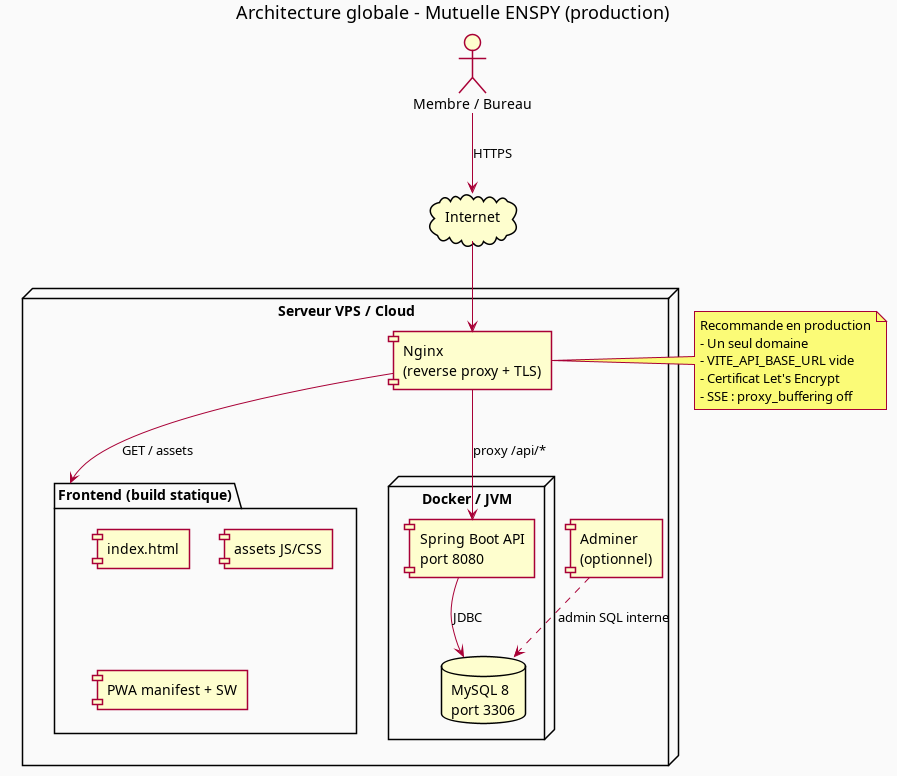
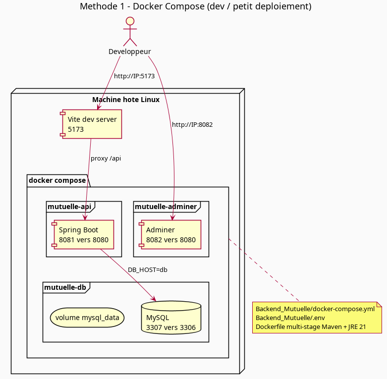
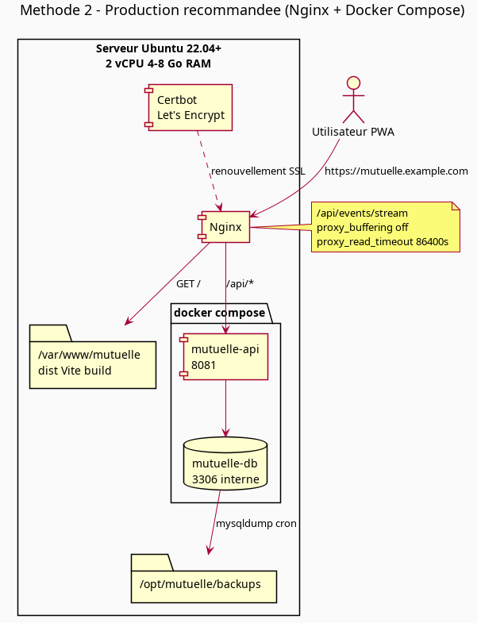
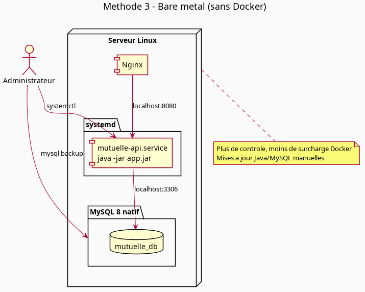
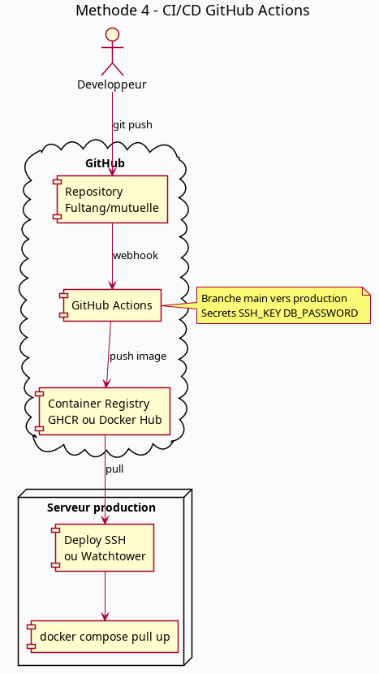

# Guide de déploiement — Mutuelle ENSPY

Ce document décrit comment déployer l’application **Mutuelle ENSPY** en production ou en environnement de test. Le projet est composé de :

| Composant | Technologie | Répertoire |
|-----------|-------------|------------|
| **Frontend** | React 18 + Vite + PWA | `Frontend_Mutuelle/` |
| **Backend** | Spring Boot 3 + Java 21 | `Backend_Mutuelle/` |
| **Base de données** | MySQL 8 + Flyway | via Docker ou installation native |
| **Temps réel** | SSE (`/api/events/stream`) | pas de WebSocket |

Dépôt Git : [github.com/Fultang/mutuelle](https://github.com/Fultang/mutuelle) (branche active : `feature/membres`).

---

## Sommaire

1. [Architecture cible](#1-architecture-cible)
2. [Spécifications serveur](#2-spécifications-serveur)
3. [Prérequis communs](#3-prérequis-communs)
4. [Méthode 1 — Docker Compose (dev / staging)](#4-méthode-1--docker-compose-dev--staging)
5. [Méthode 2 — Production Nginx + Docker (recommandée)](#5-méthode-2--production-nginx--docker-recommandée)
6. [Méthode 3 — Bare metal (sans Docker)](#6-méthode-3--bare-metal-sans-docker)
7. [Méthode 4 — CI/CD avec GitHub Actions](#7-méthode-4--cicd-avec-github-actions)
8. [Variables d’environnement](#8-variables-denvironnement)
9. [PWA, SSE et reverse proxy](#9-pwa-sse-et-reverse-proxy)
10. [Sauvegardes et sécurité](#10-sauvegardes-et-sécurité)
11. [Vérifications post-déploiement](#11-vérifications-post-déploiement)
12. [Regénérer les diagrammes PlantUML](#12-regénérer-les-diagrammes-plantuml)

---

## 1. Architecture cible

En production, l’architecture recommandée expose **un seul domaine HTTPS** : le frontend statique est servi par Nginx, et les appels API passent par le même domaine via `/api/*` (évite les problèmes CORS et simplifie la PWA).



**Flux utilisateur :**

1. Le membre ou le bureau ouvre `https://mutuelle.example.com` sur mobile ou desktop.
2. Nginx sert les fichiers statiques (HTML, JS, CSS, icônes PWA).
3. Le JavaScript appelle `/api/...` (URL relative si `VITE_API_BASE_URL` est vide).
4. Nginx proxyfie `/api` vers Spring Boot (port interne 8080 ou 8081).
5. L’API interroge MySQL ; Flyway applique les migrations au démarrage.
6. Le frontend maintient une connexion SSE vers `/api/events/stream` pour rafraîchir les écrans après chaque mutation.

Sources PlantUML : [`docs/deployment/architecture-globale.puml`](docs/deployment/architecture-globale.puml)

---

## 2. Spécifications serveur

### Environnement minimal (staging, ~60 membres, faible charge)

| Ressource | Valeur |
|-----------|--------|
| **vCPU** | 2 |
| **RAM** | 4 Go |
| **Disque** | 40 Go SSD |
| **OS** | Ubuntu 22.04 LTS ou Debian 12 |
| **Réseau** | IP publique, ports 22 (SSH), 80/443 (HTTP/S) |

Répartition mémoire indicative :
- MySQL : 1–1,5 Go
- JVM Spring Boot : 512 Mo – 1 Go (`-Xmx512m` suffit au départ)
- Nginx + OS : ~500 Mo

### Environnement production recommandé

| Ressource | Valeur |
|-----------|--------|
| **vCPU** | 2–4 |
| **RAM** | 8 Go |
| **Disque** | 80 Go SSD (données + sauvegardes 30 jours) |
| **OS** | Ubuntu 22.04 LTS |
| **Sauvegarde** | Snapshot disque ou dump MySQL quotidien |

### Fournisseurs compatibles

- **Hetzner** (CX22 / CPX21) — bon rapport qualité/prix en Europe
- **DigitalOcean** (Droplet 4 Go)
- **OVH** VPS Value
- **Serveur on-premise ENSPY** — même stack, accès réseau interne possible

### Ports à ouvrir

| Port | Service | Exposition |
|------|---------|------------|
| **443** | HTTPS (Nginx) | Public |
| **80** | HTTP → redirection HTTPS | Public |
| **8081** | API Spring (si pas de Nginx devant) | **Interne uniquement** |
| **3306 / 3307** | MySQL | **Jamais public** |
| **8082** | Adminer | **Interne / VPN uniquement** |
| **5173** | Vite dev | **Dev uniquement, jamais en prod** |

---

## 3. Prérequis communs

Sur le serveur :

```bash
# Ubuntu / Debian
sudo apt update && sudo apt install -y git curl

# Docker (méthodes 1, 2, 4)
curl -fsSL https://get.docker.com | sh
sudo usermod -aG docker $USER

# Node.js 20 LTS (build frontend)
curl -fsSL https://deb.nodesource.com/setup_20.x | sudo -E bash -
sudo apt install -y nodejs

# Nginx + Certbot (méthode 2)
sudo apt install -y nginx certbot python3-certbot-nginx
```

Clone du dépôt :

```bash
git clone https://github.com/Fultang/mutuelle.git
cd mutuelle
git checkout feature/membres   # ou main une fois fusionné
```

---

## 4. Méthode 1 — Docker Compose (dev / staging)

**Usage :** développement local, démo sur le réseau interne, petit déploiement sans domaine ni TLS.



Source : [`docs/deployment/methode-docker-compose.puml`](docs/deployment/methode-docker-compose.puml)

### 4.1. Configuration

Créer `Backend_Mutuelle/.env` (ne **jamais** committer ce fichier) :

```env
DB_NAME=mutuelle_db
DB_USER=mutuelle_user
DB_PASSWORD=<mot_de_passe_fort>
DB_ROOT_PASSWORD=<root_fort>
DB_PORT=3307
SPRING_LOCAL_PORT=8081
SPRING_DOCKER_PORT=8080
ADMINER_PORT=8082
```

### 4.2. Démarrage backend + base

```bash
cd Backend_Mutuelle
docker compose up -d --build
docker compose ps
docker compose logs -f app
```

Services :
- **API** : `http://<IP>:8081`
- **MySQL** : port hôte `3307`
- **Adminer** : `http://<IP>:8082` (à restreindre en prod)

### 4.3. Frontend en mode développement

```bash
cd Frontend_Mutuelle
npm ci
npm run dev
```

Accès : `http://<IP>:5173` — le proxy Vite redirige `/api` vers `localhost:8081`.

Fichier `.env.development` :

```env
VITE_API_BASE_URL=
VITE_BACKEND_HOST=localhost
VITE_BACKEND_PORT=8081
```

### 4.4. Avantages / limites

| Avantages | Limites |
|-----------|---------|
| Mise en route rapide | Pas de TLS natif |
| Reproductible (Dockerfile multi-stage) | Vite dev non adapté à la prod |
| Adminer pratique pour debug | Ports multiples exposés |

**Ne pas utiliser `npm run dev` en production.** Préférer la méthode 2 avec build statique.

---

## 5. Méthode 2 — Production Nginx + Docker (recommandée)

**Usage :** déploiement public avec HTTPS, PWA installable, un seul domaine.



Source : [`docs/deployment/methode-nginx-prod.puml`](docs/deployment/methode-nginx-prod.puml)

### 5.1. Build du frontend

```bash
cd Frontend_Mutuelle
npm ci

# URLs relatives : le navigateur appelle /api sur le même domaine
echo 'VITE_API_BASE_URL=' > .env.production.local

npm run build
# Sortie : dist/
```

Déployer les fichiers statiques :

```bash
sudo mkdir -p /var/www/mutuelle
sudo rsync -av --delete dist/ /var/www/mutuelle/
sudo chown -R www-data:www-data /var/www/mutuelle
```

### 5.2. Backend Docker Compose

Sur le serveur, placer le projet dans `/opt/mutuelle` :

```bash
sudo mkdir -p /opt/mutuelle
sudo git clone https://github.com/Fultang/mutuelle.git /opt/mutuelle
cd /opt/mutuelle/Backend_Mutuelle
# Configurer .env (cf. section 4.1)
docker compose up -d --build
```

L’API écoute sur `127.0.0.1:8081` (mapper uniquement en local si possible).

### 5.3. Configuration Nginx

Fichier `/etc/nginx/sites-available/mutuelle` :

```nginx
server {
    listen 80;
    server_name mutuelle.example.com;
    return 301 https://$host$request_uri;
}

server {
    listen 443 ssl http2;
    server_name mutuelle.example.com;

    ssl_certificate     /etc/letsencrypt/live/mutuelle.example.com/fullchain.pem;
    ssl_certificate_key /etc/letsencrypt/live/mutuelle.example.com/privkey.pem;

    root /var/www/mutuelle;
    index index.html;

    # PWA : fallback SPA sauf /api
    location / {
        try_files $uri $uri/ /index.html;
    }

    # Cache agressif pour les assets hashés Vite
    location /assets/ {
        expires 1y;
        add_header Cache-Control "public, immutable";
    }

    # API REST
    location /api/ {
        proxy_pass http://127.0.0.1:8081;
        proxy_http_version 1.1;
        proxy_set_header Host $host;
        proxy_set_header X-Real-IP $remote_addr;
        proxy_set_header X-Forwarded-For $proxy_add_x_forwarded_for;
        proxy_set_header X-Forwarded-Proto $scheme;
    }

    # SSE — connexion longue durée, pas de buffering
    location /api/events/stream {
        proxy_pass http://127.0.0.1:8081;
        proxy_http_version 1.1;
        proxy_set_header Connection '';
        proxy_set_header Cache-Control no-cache;
        proxy_buffering off;
        proxy_cache off;
        chunked_transfer_encoding off;
        proxy_read_timeout 86400s;
        proxy_send_timeout 86400s;
    }
}
```

Activer le site et obtenir le certificat :

```bash
sudo ln -s /etc/nginx/sites-available/mutuelle /etc/nginx/sites-enabled/
sudo certbot --nginx -d mutuelle.example.com
sudo nginx -t && sudo systemctl reload nginx
```

### 5.4. Profil Spring Boot production

Créer `Backend_Mutuelle/src/main/resources/application-prod.properties` (ou variables d’environnement) :

```properties
spring.jpa.show-sql=false
spring.devtools.restart.enabled=false
logging.level.root=INFO
```

Lancer avec :

```yaml
# docker-compose.yml — service app
environment:
  - SPRING_PROFILES_ACTIVE=prod
```

### 5.5. Mise à jour

```bash
cd /opt/mutuelle
git pull

# Backend
cd Backend_Mutuelle && docker compose up -d --build

# Frontend
cd ../Frontend_Mutuelle
npm ci && npm run build
sudo rsync -av --delete dist/ /var/www/mutuelle/
```

### 5.6. Avantages

- Un domaine, TLS, PWA « Add to Home Screen »
- Pas de CORS (same-origin)
- SSE fonctionne avec la config dédiée Nginx
- Isolation MySQL dans Docker, API rebuildable

---

## 6. Méthode 3 — Bare metal (sans Docker)

**Usage :** serveur où Docker n’est pas autorisé, ou contrainte d’infogérance imposant MySQL/Java natifs.



Source : [`docs/deployment/methode-bare-metal.puml`](docs/deployment/methode-bare-metal.puml)

### 6.1. MySQL natif

```bash
sudo apt install -y mysql-server
sudo mysql_secure_installation

sudo mysql -e "CREATE DATABASE mutuelle_db CHARACTER SET utf8mb4;"
sudo mysql -e "CREATE USER 'mutuelle_user'@'localhost' IDENTIFIED BY '<password>';"
sudo mysql -e "GRANT ALL ON mutuelle_db.* TO 'mutuelle_user'@'localhost';"
```

### 6.2. Build et installation de l’API

```bash
sudo apt install -y openjdk-21-jdk maven
cd Backend_Mutuelle
mvn package -DskipTests

sudo mkdir -p /opt/mutuelle-api
sudo cp target/*.jar /opt/mutuelle-api/app.jar
```

Service systemd `/etc/systemd/system/mutuelle-api.service` :

```ini
[Unit]
Description=Mutuelle ENSPY API
After=mysql.service

[Service]
User=mutuelle
WorkingDirectory=/opt/mutuelle-api
Environment=DB_HOST=localhost
Environment=DB_PORT=3306
Environment=DB_NAME=mutuelle_db
Environment=DB_USER=mutuelle_user
Environment=DB_PASSWORD=<password>
Environment=SPRING_PROFILES_ACTIVE=prod
ExecStart=/usr/bin/java -Xmx512m -jar /opt/mutuelle-api/app.jar
Restart=on-failure

[Install]
WantedBy=multi-user.target
```

```bash
sudo useradd -r -s /bin/false mutuelle
sudo systemctl daemon-reload
sudo systemctl enable --now mutuelle-api
```

### 6.3. Frontend + Nginx

Identique à la [section 5](#5-méthode-2--production-nginx--docker-recommandée) : build Vite, `/var/www/mutuelle`, proxy `/api` vers `127.0.0.1:8080` (port par défaut Spring).

### 6.4. Comparaison

| Critère | Docker Compose | Bare metal |
|---------|----------------|------------|
| Reproductibilité | Excellente | Moyenne |
| Mises à jour Java/MySQL | Via image / compose | Paquets système |
| Sauvegarde MySQL | Volume Docker | `mysqldump` natif |
| Courbe d’apprentissage | Faible | Plus élevée |

---

## 7. Méthode 4 — CI/CD avec GitHub Actions

**Usage :** déploiement automatique à chaque push sur `main` (ou `feature/membres` pour staging).



Source : [`docs/deployment/methode-cicd.puml`](docs/deployment/methode-cicd.puml)

### 7.1. Pipeline type

1. **Push** sur GitHub
2. **GitHub Actions** : tests backend, build JAR, build frontend, image Docker
3. **Push image** vers GHCR (`ghcr.io/fultang/mutuelle-api:latest`)
4. **Déploiement** sur le serveur via SSH ou Watchtower

Exemple `.github/workflows/deploy.yml` (à adapter) :

```yaml
name: Deploy

on:
  push:
    branches: [main]

jobs:
  build:
    runs-on: ubuntu-latest
    steps:
      - uses: actions/checkout@v4

      - name: Set up JDK 21
        uses: actions/setup-java@v4
        with:
          java-version: '21'
          distribution: 'temurin'

      - name: Build backend
        working-directory: Backend_Mutuelle
        run: mvn -B package -DskipTests

      - name: Build frontend
        working-directory: Frontend_Mutuelle
        run: |
          npm ci
          npm run build
        env:
          VITE_API_BASE_URL: ''

      - name: Build & push Docker image
        uses: docker/build-push-action@v5
        with:
          context: Backend_Mutuelle
          push: true
          tags: ghcr.io/fultang/mutuelle-api:latest

  deploy:
    needs: build
    runs-on: ubuntu-latest
    steps:
      - name: Deploy via SSH
        uses: appleboy/ssh-action@v1
        with:
          host: ${{ secrets.DEPLOY_HOST }}
          username: ${{ secrets.DEPLOY_USER }}
          key: ${{ secrets.DEPLOY_SSH_KEY }}
          script: |
            cd /opt/mutuelle && git pull
            cd Backend_Mutuelle && docker compose pull && docker compose up -d
            rsync -av Frontend_Mutuelle/dist/ /var/www/mutuelle/
```

### 7.2. Secrets GitHub à configurer

| Secret | Description |
|--------|-------------|
| `DEPLOY_HOST` | IP ou hostname du serveur |
| `DEPLOY_USER` | Utilisateur SSH |
| `DEPLOY_SSH_KEY` | Clé privée SSH |
| `DB_PASSWORD` | Mot de passe MySQL (si injecté au build) |

### 7.3. Alternative simple : script de déploiement manuel

```bash
#!/bin/bash
# deploy.sh sur le serveur
set -e
cd /opt/mutuelle
git pull
cd Backend_Mutuelle && docker compose up -d --build
cd ../Frontend_Mutuelle && npm ci && npm run build
rsync -av --delete dist/ /var/www/mutuelle/
echo "Déploiement terminé $(date)"
```

---

## 8. Variables d’environnement

### Backend (`Backend_Mutuelle/.env` ou environnement Docker)

| Variable | Exemple | Description |
|----------|---------|-------------|
| `DB_HOST` | `db` / `localhost` | Hôte MySQL |
| `DB_PORT` | `3306` | Port MySQL |
| `DB_NAME` | `mutuelle_db` | Nom de la base |
| `DB_USER` | `mutuelle_user` | Utilisateur |
| `DB_PASSWORD` | *(secret)* | Mot de passe |
| `SPRING_LOCAL_PORT` | `8081` | Port exposé sur l’hôte |
| `SPRING_DOCKER_PORT` | `8080` | Port interne conteneur |
| `SPRING_PROFILES_ACTIVE` | `prod` | Profil Spring |

### Frontend (build time — préfixe `VITE_`)

| Variable | Production (same-origin) | Frontend séparé |
|----------|--------------------------|-----------------|
| `VITE_API_BASE_URL` | *(vide)* | `https://api.example.com` |
| `VITE_BACKEND_HOST` | utilisé en dev/preview | — |
| `VITE_BACKEND_PORT` | `8081` | — |

> Les variables `VITE_*` sont **incluses dans le bundle JS au build**. Toute modification nécessite un rebuild (`npm run build`).

---

## 9. PWA, SSE et reverse proxy

### PWA

- Manifest et service worker générés par `vite-plugin-pwa`
- En production : **HTTPS obligatoire** pour l’installation sur mobile
- `display: standalone` — expérience type application native
- Tester l’installation : Chrome → « Ajouter à l’écran d’accueil »

### SSE (Server-Sent Events)

Le frontend se connecte à `/api/events/stream` (`Frontend_Mutuelle/src/services/serverEvents.js`). Après chaque mutation API réussie, tous les clients reçoivent un événement `refresh`.

**Points critiques derrière Nginx :**

- `proxy_buffering off` sur la route SSE
- `proxy_read_timeout` élevé (86400 s)
- Ne pas mettre de cache sur `/api/events/stream`

En dev, Vite configure déjà les en-têtes SSE dans `vite.config.js`.

### CORS

Le backend autorise toutes les origines (`WebConfig.java`). En production same-origin (méthode 2), CORS n’est pas un problème. Si le frontend est hébergé sur un autre domaine, restreindre `allowedOriginPatterns` au domaine frontend.

---

## 10. Sauvegardes et sécurité

### Sauvegarde MySQL

```bash
# Dump quotidien (cron)
0 2 * * * docker exec mutuelle-db mysqldump -u root -p'$DB_ROOT_PASSWORD' mutuelle_db \
  | gzip > /opt/mutuelle/backups/mutuelle_$(date +\%Y\%F).sql.gz
```

Conserver 30 jours minimum. Tester la restauration régulièrement :

```bash
gunzip -c backup.sql.gz | docker exec -i mutuelle-db mysql -u root -p mutuelle_db
```

### Sécurité

- **Ne jamais** exposer MySQL (3306) ni Adminer (8082) sur Internet
- Mots de passe forts pour `DB_PASSWORD` et comptes membres
- Désactiver `spring.jpa.show-sql` en production
- Mettre à jour le OS et Docker régulièrement
- Ne pas committer `.env`, `members.json` (contient des mots de passe en clair)
- Restreindre SSH (clés uniquement, fail2ban)

### Données opérationnelles existantes

Si la base contient déjà des membres et des caisses importés, **sauvegarder avant tout redéploiement** qui recréerait le volume Docker. Le script `Backend_Mutuelle/reset_operational_data.sql` efface les données opérationnelles — à utiliser uniquement en dev.

---

## 11. Vérifications post-déploiement

Checklist :

- [ ] `https://mutuelle.example.com` charge l’interface
- [ ] Connexion membre et compte bureau fonctionnent
- [ ] `GET https://mutuelle.example.com/api/hello` retourne une réponse
- [ ] SSE : ouvrir deux onglets, modifier un versement → l’autre onglet se rafraîchit
- [ ] PWA installable sur Android / iOS
- [ ] Certificat SSL valide (A+ sur SSL Labs si public)
- [ ] Logs API sans erreur Flyway : `docker compose logs app`
- [ ] Sauvegarde automatique configurée et testée

Commandes utiles :

```bash
# Santé conteneurs
docker compose ps

# Logs API
docker compose logs -f app --tail=100

# Test API locale
curl -s http://127.0.0.1:8081/api/hello

# Test HTTPS
curl -I https://mutuelle.example.com
```

---

## 12. Regénérer les diagrammes PlantUML

Les diagrammes sont versionnés en `.puml` dans `docs/deployment/`. Pour regénérer les PNG :

```bash
cd docs/deployment
plantuml -tpng *.puml
```

Prérequis : [PlantUML](https://plantuml.com/) + Java (`sudo apt install plantuml` sur Ubuntu).

Fichiers :

| Fichier | Description |
|---------|-------------|
| `architecture-globale.puml` | Vue d’ensemble production |
| `methode-docker-compose.puml` | Dev / staging Docker |
| `methode-nginx-prod.puml` | Production Nginx + Docker |
| `methode-bare-metal.puml` | Installation native |
| `methode-cicd.puml` | Pipeline GitHub Actions |

---

## Récapitulatif des méthodes

| Méthode | Contexte | TLS | Difficulté | Recommandation |
|---------|----------|-----|------------|----------------|
| **1. Docker Compose seul** | Dev, réseau local | Non | Facile | Développement uniquement |
| **2. Nginx + Docker** | Production publique | Oui | Moyenne | **Recommandée** |
| **3. Bare metal** | Contraintes infra | Oui (Nginx) | Élevée | Si Docker interdit |
| **4. CI/CD** | Équipe, mises à jour fréquentes | Oui | Moyenne–élevée | Après stabilisation |

Pour toute question sur le fonctionnement métier (exercices, caisses, rôles), voir [`FONCTIONNEMENT_MUTUELLE.md`](FONCTIONNEMENT_MUTUELLE.md).
