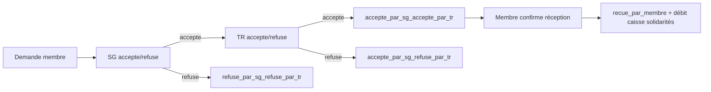
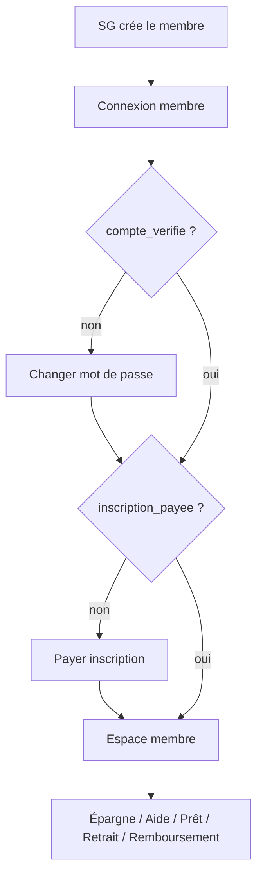
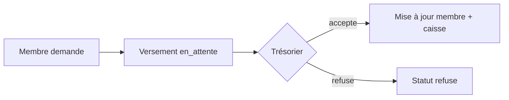
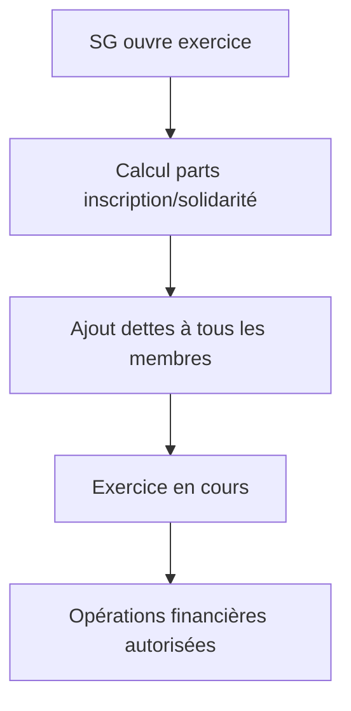

# Fonctionnement de la Mutuelle ENSPY

Document de référence décrivant le comportement **réellement implémenté** dans l’application Mutuelle (backend Spring Boot + frontend React PWA).

> **Source de vérité :** code dans `Backend_Mutuelle/` et `Frontend_Mutuelle/`, complété par `Backend_Mutuelle/description.md`.

---

## Table des matières

1. [Vue d’ensemble](#1-vue-densemble)
2. [Acteurs, rôles et interfaces](#2-acteurs-rôles-et-interfaces)
3. [Authentification et onboarding membre](#3-authentification-et-onboarding-membre)
4. [Exercices](#4-exercices)
5. [Les trois caisses](#5-les-trois-caisses)
6. [Inscription](#6-inscription)
7. [Solidarité](#7-solidarité)
8. [Épargne](#8-épargne)
9. [Statuts des membres](#9-statuts-des-membres)
10. [Assistances](#10-assistances)
11. [Prêts](#11-prêts)
12. [Retraits d’épargne](#12-retraits-dépargne)
13. [Remboursements de prêts](#13-remboursements-de-prêts)
14. [Pénalités et échéances](#14-pénalités-et-échéances)
15. [Paramètres configurables](#15-paramètres-configurables)
16. [Récapitulatif des champs financiers membre](#16-récapitulatif-des-champs-financiers-membre)
17. [Schémas de flux](#17-schémas-de-flux)
18. [Fonctionnalités non implémentées](#18-fonctionnalités-non-implémentées)

---

## 1. Vue d’ensemble

La mutuelle est une association d’entraide financière. Chaque **membre** dispose d’un compte avec :

- une **épargne** et des **intérêts** cumulés ;
- des **dettes** d’inscription, de solidarité et d’emprunt ;
- un **état** calculé automatiquement à partir de la dette de solidarité.

La trésorerie globale est répartie en **trois caisses** (table `parametres_generaux`) :

| Caisse | Champ | Rôle |
|--------|-------|------|
| Inscriptions | `caisse_inscriptions` | Paiements d’inscription |
| Solidarités | `caisse_solidarites` | Cotisations de solidarité et financement des aides |
| Épargnes | `caisse_epargnes` | Épargnes, prêts, remboursements, retraits |

Les opérations financières (versements, sorties, remboursements) ne sont possibles que lorsqu’un **exercice est en cours**. Chaque opération est rattachée à l’exercice courant via `exercice_id`.

---

## 2. Acteurs, rôles et interfaces

### Postes du bureau

Chaque poste est occupé par un **membre** et possède un login/mot de passe d’administration distinct.

| Poste | Code | Interface |
|-------|------|-----------|
| Secrétaire général | `SECRETAIRE_GENERAL` | `/sg` |
| Trésorier | `TRESORIER` | `/tr` |
| Président | `PRESIDENT` | `/president` |
| Commissaire aux comptes | `COMMISSAIRE_AUX_COMPTES` | `/commissaire` |
| Membre | — | `/membre` |

Logins par défaut : `secretaire_general@mutuelle.cm`, `tresorier@mutuelle.cm`, `president@mutuelle.cm`, `commissaire_aux_comptes@mutuelle.cm` (mot de passe initial : `MonMot2Passe!`).

### Actions par rôle (implémenté)

| Rôle | Actions principales |
|------|-------------------|
| **Secrétaire général** | Créer/modifier les membres ; ouvrir/clôturer les exercices ; valider/refuser les sorties (1er niveau) ; consulter caisses, historiques, paramètres, types d’aides, postes |
| **Trésorier** | Accepter/refuser les versements ; valider/refuser les sorties (2e niveau) ; valider/refuser les remboursements ; consulter caisses et flux |
| **Président** | Consultation : caisses, membres, flux, historiques (épargnes, inscriptions, solidarités, emprunts, sorties) |
| **Commissaire** | Consultation : caisses, membres, flux, historiques, versements |
| **Membre** | Activer son compte ; payer l’inscription ; épargner ; demander aide, prêt ou retrait ; rembourser un prêt ; gérer son profil |

Tous les rôles bureau disposent d’une page **Mon compte** (`/sg/compte`, `/tr/compte`, etc.) pour modifier leurs informations personnelles et leurs identifiants de connexion administration.

---

## 3. Authentification et onboarding membre

### Création d’un membre (SG)

Le SG renseigne : nom, prénom, e-mail, téléphone, photo (optionnel), et peut indiquer si l’inscription est déjà payée.

À la création :

- `compte_verifie = false`
- `inscription_payee` = valeur fournie ou `false`
- `solidarite_payee = false`
- `dette_inscription` = montant d’inscription des paramètres généraux (ou `0` si déjà payée)
- `dette_solidarite` = montant de solidarité des paramètres généraux
- `epargne`, `interet`, `dette` (emprunt) = `0`
- Mot de passe généré : `MonMot2Passe!` (loggé côté serveur, pas d’envoi e-mail)

### Parcours membre après connexion

1. **Activer le compte** (`/membre/activer`) : le membre change son mot de passe → `compte_verifie = true`
2. **Payer l’inscription** (`/membre/inscription`) : si `inscription_payee = false`
3. **Accès à l’espace membre** (`/membre`) : épargne, retrait, aide, emprunt, profil

Le frontend redirige automatiquement vers l’étape obligatoire via `MembreOnboardingGate`.

---

## 4. Exercices

### Principe

- Un exercice représente une période d’activité de la mutuelle.
- **Un seul exercice « en cours »** à la fois.
- Statuts : `en cours`, `ferme`.
- Les dettes et épargnes des membres **persistent** d’un exercice à l’autre.

### Ouverture (SG)

Endpoint : `POST /api/exercices/ouvrir` (ou `/ouvrir-force`).

**Conditions :**

- Aucun exercice déjà en cours ;
- Au moins un membre enregistré ;
- Mode normal : aucun prêt `non rembourse` ;
- Mode forcé : ignore les prêts non remboursés.

**À l’ouverture**, le système recalcule les dettes d’inscription et de solidarité de **tous** les membres :

```
cmax_solidarite  = montant_solidarite × nombre_total_membres
cmax_inscription = montant_inscription × nombre_total_membres

diviseur = nombre de membres « a jour », ou total si aucun « a jour »

part_solidarite  = arrondi supérieur (cmax_solidarite  ÷ diviseur)
part_inscription = arrondi supérieur (cmax_inscription ÷ diviseur)
```

Pour chaque membre :

- `dette_solidarite += part_solidarite`
- `dette_inscription += part_inscription`
- Si dette > 0 → `solidarite_payee` / `inscription_payee` repassent à `false`
- L’état est recalculé (voir section 9)

### Clôture (SG)

Endpoint : `POST /api/exercices/cloturer`.

**Conditions :**

- Un exercice est en cours ;
- Aucun prêt `non rembourse`.

**Effet :** statut → `ferme`, `date_fermeture` renseignée. Pas de calcul supplémentaire à la clôture.

### Exigence exercice

Toute opération financière (versement, sortie, remboursement) exige un exercice en cours. Sinon : *« Aucun exercice en cours. Opération impossible. »*

---

## 5. Les trois caisses

Les soldes sont stockés dans `parametres_generaux` et mis à jour lors des validations trésorier.

| Caisse | Entrées | Sorties |
|--------|---------|---------|
| **Inscriptions** | Versements d’inscription acceptés | — |
| **Solidarités** | Versements de solidarité acceptés | Aides confirmées par le membre |
| **Épargnes** | Versements d’épargne acceptés ; remboursements validés | Prêts accordés (net d’intérêts) ; retraits confirmés ; pénalités prélevées |

---

## 6. Inscription

### Montant

Défini dans `parametres_generaux.montant_inscription` (défaut : **50 000 FCFA**).

### Demande (membre)

1. Le membre appelle `POST /api/versements/inscription` avec le montant exact requis.
2. Un versement est créé : `raison = inscription`, `statut = en_attente`.

### Validation (trésorier)

- **Accepter** : `dette_inscription` diminue du montant ; si `dette_inscription = 0` → `inscription_payee = true` ; caisse inscriptions créditée.
- **Refuser** : statut `refuse`, aucun effet sur les dettes.

Le paiement doit correspondre **exactement** au montant d’inscription configuré (pas de paiement partiel).

---

## 7. Solidarité

### Montant de référence

`parametres_generaux.montant_solidarite` (défaut : **150 000 FCFA**).

À la création, chaque membre reçoit cette dette initiale. À chaque ouverture d’exercice, une **part** supplémentaire est ajoutée (voir section 4).

### Demande (membre)

1. `POST /api/versements/solidarite` avec un montant > 0 et ≤ `dette_solidarite`.
2. Versement créé en `en_attente`.

### Validation (trésorier)

- **Accepter** : `dette_solidarite` diminue ; si `dette_solidarite = 0` → `solidarite_payee = true` ; état recalculé ; caisse solidarités créditée.
- **Refuser** : statut `refuse`.

Les paiements partiels sont autorisés.

---

## 8. Épargne

### Versement

1. Membre : `POST /api/versements/epargne` (montant > 0).
2. Trésorier accepte → `epargne` du membre augmente, caisse épargnes créditée.

### Solde total

`GET /api/membres/{id}/solde-total` retourne :

```
solde_total = epargne + interet
```

Les intérêts proviennent de la répartition lors des octrois de prêts (section 11).

---

## 9. Statuts des membres

Le champ `etat` est recalculé automatiquement (`@PrePersist` / `@PreUpdate`) à partir de **`dette_solidarite` uniquement** :

| État | Condition |
|------|-----------|
| `a jour` | `dette_solidarite = 0` |
| `non a jour` | `0 < dette_solidarite < 250 000` |
| `Inactif` | `dette_solidarite ≥ 250 000` |

> La dette d’inscription et la dette d’emprunt **n’influencent pas** directement l’état, mais bloquent certaines opérations (aide, prêt).

---

## 10. Assistances

### Types d’aides configurables

Table `parametres_aides` (types par défaut) :

| Type | Montant par défaut |
|------|-------------------|
| `deces` | 500 000 FCFA |
| `maladie` | 100 000 FCFA |
| `mariage` | 50 000 FCFA |

Le SG peut créer, modifier et supprimer des types via `/sg/parametres`.

### Éligibilité

`GET /api/membres/{id}/eligible-aide` vérifie :

- `inscription_payee = true`
- `solidarite_payee = true`

### Demande (membre)

1. Choisir un type d’aide existant.
2. Vérification : caisse solidarités ≥ montant de l’aide.
3. Création d’une **sortie** : `raison = aide_{type}`, statut `en_attente_secretaire_general`.

### Circuit de validation



La caisse solidarités n’est débitée qu’à la **confirmation du membre** (`POST /api/sorties/{id}/confirmer-membre`).

---

## 11. Prêts

### Éligibilité

`GET /api/membres/{id}/eligible-pret` vérifie :

- Inscription soldée (`inscription_payee` et `dette_inscription = 0`)
- Solidarité soldée (`solidarite_payee` et `dette_solidarite = 0`)
- Aucun emprunt en cours (`dette = 0`)
- Caisse épargnes suffisante

### Plafond

```
montant_max = epargne × facteur_emprunt
```

`facteur_emprunt` est configurable (défaut : **5**). Pas de paliers par tranche d’épargne.

### Demande et validation

1. Membre : `POST /api/sorties/demande-pret` → sortie `raison = pret`.
2. SG accepte → `en_attente_tresorier`.
3. TR accepte → **finalisation automatique** (pas de confirmation membre).

### Effets à la validation trésorier

```
interets = montant × taux_interet_emprunts   (arrondi entier inférieur)
montant_net_caisse = montant - interets
```

- Caisse épargnes diminuée du montant net ;
- Prêt enregistré : `statut = non rembourse`, échéance = maintenant + `duree_maximale_emprunt` mois ;
- `dette` du membre augmentée du **capital** (montant demandé) ;
- Intérêts redistribués proportionnellement à l’épargne des **autres** membres (champ `interet`).

Le membre rembourse uniquement le **capital**, pas les intérêts d’octroi.

---

## 12. Retraits d’épargne

### Demande (membre)

`POST /api/sorties/demande-retrait` : montant ≤ épargne du membre.

### Circuit

Même validation SG → TR que les aides. Le membre doit **confirmer la réception**.

### Effets à la confirmation

- Caisse épargnes diminuée ;
- `epargne` du membre diminuée ;
- `interet` diminué proportionnellement au ratio `montant / epargne`.

---

## 13. Remboursements de prêts

### Demande (membre)

`POST /api/remboursements` avec `pretId` et `montant` :

- Montant > 0 et ≤ reste à rembourser (dette − remboursements déjà en attente).

### Validation (trésorier)

- **Valider** : `dette` diminue ; caisse épargnes créditée ; si `dette = 0` → prêt `rembourse`.
- **Refuser** : statut `refuse_tr`, aucun effet financier.

---

## 14. Pénalités et échéances

### Vérification des échéances

- Tâche planifiée quotidienne (minuit) ;
- Endpoint manuel : `POST /api/prets/verifier-echeances` ;
- Horloge simulable via `/api/simulation/horloge` (tests).

Pour chaque prêt `non rembourse` dont l’échéance est atteinte : notifications loggées (président, SG, membre).

### Application d’une pénalité

`POST /api/prets/{id}/appliquer-penalite` (après échéance) :

```
pénalité = montant_penalite_retard + (dette × taux_interet_emprunts)
```

Prélevée sur l’**épargne** du membre (refusée si épargne insuffisante). La caisse épargnes est également diminuée.

> Les pénalités ne sont **pas** appliquées automatiquement à intervalles réguliers : elles sont déclenchées manuellement via l’API.

---

## 15. Paramètres configurables

Table `parametres_generaux` (une seule ligne) :

| Paramètre | Défaut | Description |
|-----------|--------|-------------|
| `montant_inscription` | 50 000 | Montant d’inscription |
| `montant_solidarite` | 150 000 | Montant de solidarité de référence |
| `taux_interet_emprunts` | 0,03 (3 %) | Intérêt à l’octroi et part variable de la pénalité |
| `montant_penalite_retard` | 15 000 | Part fixe de la pénalité |
| `facteur_emprunt` | 5 | Multiplicateur épargne → plafond prêt |
| `duree_maximale_emprunt` | 3 mois | Durée avant échéance |
| `caisse_inscriptions` | 0 | Solde caisse inscriptions |
| `caisse_solidarites` | 0 | Solde caisse solidarités |
| `caisse_epargnes` | 0 | Solde caisse épargnes |

Modifiables par le SG via `/sg/parametres`.

---

## 16. Récapitulatif des champs financiers membre

| Champ | Rôle | Impact état | Intérêts / pénalités |
|-------|------|-------------|----------------------|
| `dette_inscription` | Complément d’inscription dû | Non (mais bloque prêt/aide) | Non |
| `dette_solidarite` | Cotisation solidarité dûe | **Oui** (`a jour` / `non a jour` / `Inactif`) | Non |
| `epargne` | Épargne personnelle | Non | Reçoit part des intérêts d’emprunt |
| `interet` | Intérêts cumulés | Non | Diminué proportionnellement aux retraits |
| `dette` | Capital d’emprunt restant | Non (mais bloque nouveau prêt) | Pénalité calculée dessus |

### Versements (`versements`)

| Raison | Statuts | Validateur |
|--------|---------|------------|
| `inscription` | `en_attente`, `accepte`, `refuse` | Trésorier |
| `solidarite` | idem | Trésorier |
| `epargne` | idem | Trésorier |
| `remboursement` | *(enum présent, flux via table `remboursements`)* | — |

### Sorties (`sorties`)

| Raison | Confirmation membre | Débit caisse |
|--------|---------------------|--------------|
| `aide_{type}` | Oui | Solidarités |
| `pret` | Non (finalisé par TR) | Épargnes |
| `retrait` | Oui | Épargnes |

---

## 17. Schémas de flux

### Parcours membre



### Versement



### Ouverture d’exercice



---

## 18. Fonctionnalités non implémentées

Les éléments suivants figurent dans d’anciennes spécifications mais **ne sont pas présents** dans le code actuel :

| Fonctionnalité | Statut |
|----------------|--------|
| Sessions mensuelles de cotisation | Non implémenté |
| Renflouement (calcul à la clôture, ventilation inscription/solidarité) | Non implémenté — remplacé par le calcul de parts à l’**ouverture** d’exercice |
| Agapes | Non implémenté |
| Frais de gestion | Non implémenté |
| Validation de clôture par le commissaire | Non implémenté — le SG clôture directement |
| Super administrateur | Non implémenté |
| Complément d’inscription historique (60 000 − montant payé) | Non implémenté — montant unique configurable |
| Insolvabilité / compteurs de sessions | Non implémenté |
| Paliers d’emprunt par tranche d’épargne | Non implémenté — facteur unique |
| Redistribution d’intérêts à la clôture de session | Non implémenté — redistribution à l’octroi du prêt |
| Envoi d’e-mails (identifiants, notifications) | Non implémenté — logs serveur uniquement |

---

*Dernière mise à jour : juillet 2026 — aligné sur l’implémentation `Backend_Mutuelle` + `Frontend_Mutuelle`.*
