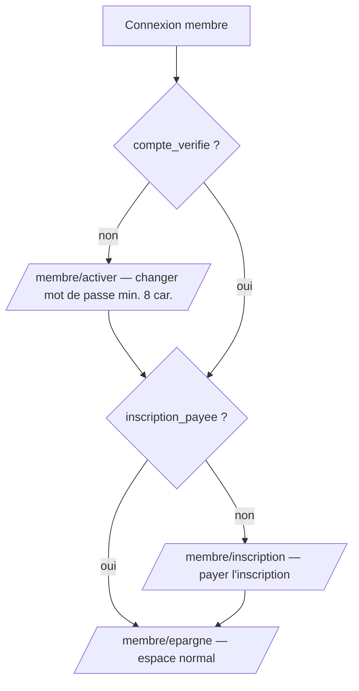
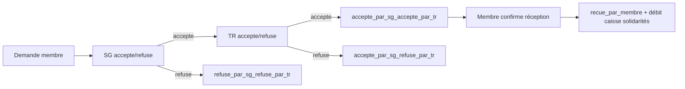
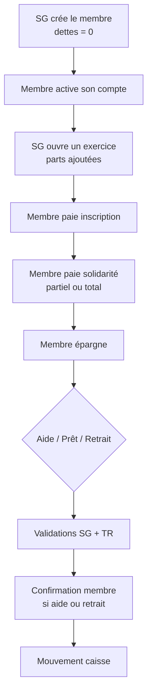
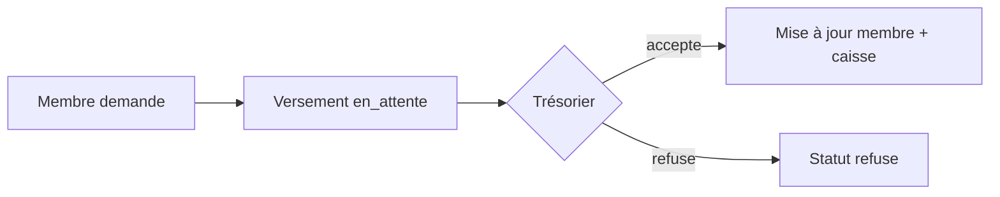
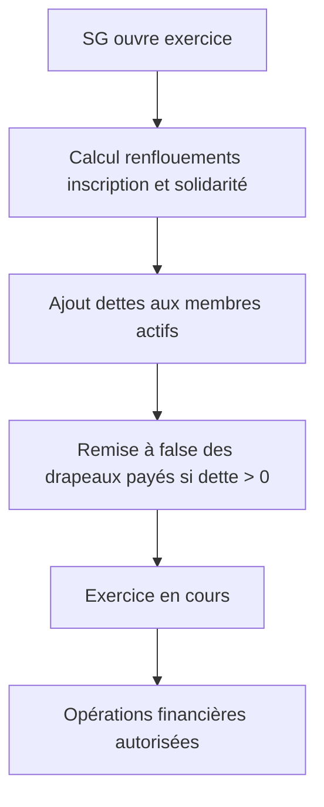

# Fonctionnement de la Mutuelle ENSPY

Document de référence décrivant le comportement **réellement implémenté** dans l’application Mutuelle (backend Spring Boot + frontend React PWA).

> **Source de vérité :** code dans `Backend_Mutuelle/` et `Frontend_Mutuelle/`. En cas de divergence avec d’anciennes spécifications (`description.md`, `scenario_creation_membre.md`), **le code prime**.

---

## Table des matières

1. [Vue d’ensemble](#1-vue-densemble)
2. [Acteurs, rôles et interfaces](#2-acteurs-rôles-et-interfaces)
3. [Parcours membre et onboarding](#3-parcours-membre-et-onboarding)
4. [Exercices](#4-exercices)
5. [Les trois caisses](#5-les-trois-caisses)
6. [Inscription](#6-inscription)
7. [Solidarité](#7-solidarité)
8. [Épargne](#8-épargne)
9. [Statuts des membres](#9-statuts-des-membres)
10. [Assistances](#10-assistances)
11. [Prêts (emprunts)](#11-prêts-emprunts)
12. [Retraits d’épargne](#12-retraits-dépargne)
13. [Remboursements de prêts](#13-remboursements-de-prêts)
14. [Pénalités et échéances](#14-pénalités-et-échéances)
15. [Paramètres configurables](#15-paramètres-configurables)
16. [Récapitulatif des champs financiers membre](#16-récapitulatif-des-champs-financiers-membre)
17. [Statuts techniques des opérations](#17-statuts-techniques-des-opérations)
18. [Rafraîchissement en temps réel (SSE)](#18-rafraîchissement-en-temps-réel-sse)
19. [Schémas de flux](#19-schémas-de-flux)
20. [Fonctionnalités non implémentées](#20-fonctionnalités-non-implémentées)
21. [Limites connues de l’implémentation](#21-limites-connues-de-limplémentation)

---

## 1. Vue d’ensemble

La mutuelle est une association d’entraide financière regroupant des **membres**. Chaque membre dispose d’un compte avec :

- une **épargne** personnelle et des **intérêts** cumulés (provenant des prêts octroyés aux autres) ;
- des **dettes** d’inscription, de solidarité et d’emprunt ;
- un **état** (`a jour`, `non a jour`, `Inactif`) calculé automatiquement à partir de la **dette de solidarité uniquement**.

La trésorerie globale est centralisée dans **trois caisses** (table `parametres_generaux`) :

| Caisse | Champ | Rôle |
|--------|-------|------|
| Inscriptions | `caisse_inscriptions` | Encaisse les paiements d’inscription |
| Solidarités | `caisse_solidarites` | Encaisse les cotisations de solidarité et finance les aides |
| Épargnes | `caisse_epargnes` | Encaisse épargnes et remboursements ; finance prêts, retraits et pénalités |

### Principe fondateur : l’exercice

Toute opération financière (versement, sortie, remboursement) exige un **exercice en cours**. Chaque opération est rattachée à l’exercice courant via `exercice_id`.

Les **dettes et épargnes persistent** d’un exercice à l’autre : la clôture ne remet rien à zéro.

### Principe de répartition des cotisations

Contrairement à une cotisation fixe immédiate à l’inscription, le modèle implémenté fonctionne ainsi :

1. À la **création**, le membre part avec **0 dette** (inscription et solidarité).
2. À chaque **ouverture d’exercice** :
   - une **part de solidarité** est ajoutée à tous les membres ;
   - une **part de renflouement d’inscription** (formule fixe `(45 000 × 12) + 60 000 + 150 000`, répartie entre les membres **actifs**) est ajoutée.
3. Les **membres actifs** se partagent le manquant des caisses (inscription et solidarité). Les membres `Inactif` n’y contribuent pas.

Ce mécanisme remplace l’ancien concept de « renflouement à la clôture » (non implémenté).

---

## 2. Acteurs, rôles et interfaces

### Postes du bureau

Chaque poste est occupé par un **membre** et possède un login/mot de passe d’administration distinct (table `postes`).

| Poste | Code | Interface |
|-------|------|-----------|
| Secrétaire général | `SECRETAIRE_GENERAL` | `/sg` |
| Trésorier | `TRESORIER` | `/tr` |
| Président | `PRESIDENT` | `/president` |
| Commissaire aux comptes | `COMMISSAIRE_AUX_COMPTES` | `/commissaire` |
| Membre | — | `/membre` |

Logins par défaut : `secretaire_general@mutuelle.cm`, `tresorier@mutuelle.cm`, `president@mutuelle.cm`, `commissaire_aux_comptes@mutuelle.cm` (mot de passe initial : `MonMot2Passe!`).

### Actions par rôle (implémenté dans l’interface)

| Rôle | Actions principales |
|------|---------------------|
| **Secrétaire général** | Créer des membres ; ouvrir/clôturer les exercices ; valider/refuser les sorties (1er niveau) ; gérer paramètres généraux et types d’aides ; affecter les postes ; appliquer les pénalités de retard sur les prêts ; consulter caisses, flux, historiques |
| **Trésorier** | Accepter/refuser les versements ; valider/refuser les sorties (2e niveau) ; valider/refuser les remboursements ; consulter caisses et flux |
| **Président** | Consultation : caisses, membres, flux, historiques (épargnes, inscriptions, solidarités, emprunts, sorties) ; déclencher la vérification des échéances |
| **Commissaire** | Consultation : caisses, membres, flux, historiques, versements |
| **Membre** | Activer son compte ; payer l’inscription ; épargner ; payer la solidarité ; demander aide, prêt ou retrait ; rembourser un prêt ; modifier son profil et son mot de passe |

**Mon compte bureau** (`/sg/compte`, `/tr/compte`, etc.) :
- Affichage **en lecture seule** des informations personnelles (nom, e-mail, téléphone) — la modification se fait depuis l’**espace membre** ;
- Changement du **mot de passe bureau** (connexion « Administration »).

**Mon compte membre** (`/membre/compte`) :
- Modification du profil (nom, prénom, e-mail, téléphone, photo) ;
- Changement du mot de passe membre.

> **Important :** le SG peut **créer** des membres mais **ne peut plus les modifier** depuis l’interface (la méthode backend `updateMembre` existe, mais n’est pas exposée côté SG).

### Sécurité et authentification

- Spring Security est configuré en **`permitAll`** : l’API ne vérifie pas les rôles côté serveur.
- Les restrictions d’accès sont appliquées **uniquement par le frontend** (`AuthGate.jsx`, routes dans `App.jsx`, session `localStorage`).
- En production, il faudrait ajouter une authentification JWT ou session côté API.

---

## 3. Parcours membre et onboarding

### Création d’un membre (SG)

Le SG renseigne : nom, prénom, e-mail, téléphone, et peut cocher « inscription déjà payée ».

À la création (`MembreService.enregistrerMembre`) :

| Champ | Valeur initiale |
|-------|-----------------|
| `compte_verifie` | `false` |
| `inscription_payee` | valeur formulaire (défaut `false`) |
| `solidarite_payee` | `false` |
| `dette_inscription` | **`0`** |
| `dette_solidarite` | **`0`** |
| `epargne`, `interet`, `dette` (emprunt) | `0` |
| `etat` | `a jour` (car solidarité = 0) |
| Mot de passe | `MonMot2Passe!` (loggé serveur, pas d’envoi e-mail) |

> **Attention :** si le SG coche « inscription déjà payée » sans versement réel, le membre **contourne** l’étape de paiement d’inscription dans l’app (`inscriptionPayee = true` alors que `detteInscription = 0`). Ce drapeau est destiné aux cas d’inscription réglée hors application.

### Étapes imposées après connexion membre

Le frontend redirige automatiquement (`auth.js` → `getHomePath()`) :



1. **Activer le compte** (`/membre/activer`) : changement de mot de passe → `compte_verifie = true`. Sans ancien mot de passe requis (première activation).
2. **Payer l’inscription** (`/membre/inscription`) : si `inscription_payee = false`.
3. **Espace membre** : épargne, solidarité (bannière), aide, emprunt, retrait, profil.

La **solidarité non soldée n’empêche pas** l’accès à l’application : une bannière persistante propose de payer, mais le membre peut utiliser l’épargne et les autres fonctions.

---

## 4. Exercices

### Principe

- Un exercice = une période d’activité de la mutuelle.
- **Un seul exercice « en cours »** à la fois (contrainte base de données).
- Statuts : `en cours`, `ferme`.

### Ouverture (SG)

Endpoints : `POST /api/exercices/ouvrir` (normal) ou `/ouvrir-force`.

**Conditions :**

| Condition | Mode normal | Mode forcé |
|-----------|-------------|------------|
| Aucun exercice en cours | Oui | Oui |
| Au moins un membre | Oui | Oui |
| Aucun prêt `non rembourse` | Oui | **Ignoré** |

**Calcul des parts à l’ouverture :**

**1. Renflouement de la caisse d’inscription** (montant fixe, puis réparti) :

```
montant_renflouement = (mensualité × nb_mois) + complément + forfait
                     = (45 000 × 12) + 60 000 + 150 000
                     = 750 000 FCFA

nb_actifs = nombre de membres dont etat ≠ "Inactif"

part_inscription = arrondi supérieur (montant_renflouement ÷ nb_actifs)
```

Cette part n’est ajoutée qu’aux **membres actifs**. Les membres `Inactif` (dette de solidarité ≥ 250 000) ne sont pas sollicités pour ce renflouement.

**2. Renflouement de la caisse de solidarité** :

```
cible            = montant_solidarite × nombre_total_membres
à_renflouer      = max(0, cible − solde_caisse_solidarites)
nb_actifs        = nombre de membres dont etat ≠ "Inactif"
part_solidarite  = arrondi supérieur (à_renflouer ÷ nb_actifs)
```

Cette part n’est ajoutée qu’aux **membres actifs**. Si la caisse de solidarité couvre déjà la cible, la part vaut **0**.

**Effets sur chaque membre actif :**

- `dette_solidarite += part_solidarite`
- `dette_inscription += part_inscription`
- Si `dette_solidarite > 0` → `solidarite_payee = false`
- Si `dette_inscription > 0` → `inscription_payee = false`
- Recalcul de `etat` selon la solidarité

**Exemple** (50 membres dont 48 actifs, caisse solidarités = 1 200 000, montant solidarité = 150 000) :

```
montant_renflouement_inscription = 750 000
part_inscription                 = CEILING(750 000 / 48) = 15 625 FCFA par membre actif

cible_solidarite = 150 000 × 50 = 7 500 000
à_renflouer      = 7 500 000 − 1 200 000 = 6 300 000
part_solidarite  = CEILING(6 300 000 / 48) = 131 250 FCFA par membre actif
```

### Clôture (SG)

Endpoint : `POST /api/exercices/cloturer`.

**Conditions :**

- Un exercice est en cours ;
- Aucun prêt `non rembourse`.

**Effet :** statut → `ferme`, `date_fermeture` renseignée. Aucun calcul financier supplémentaire.

### Exigence exercice

Sans exercice en cours, toute opération financière échoue avec : *« Aucun exercice en cours. Opération impossible. »*

Le frontend affiche une bannière `ExerciceBanner` lorsque l’exercice n’est pas ouvert.

---

## 5. Les trois caisses

Les soldes sont dans `parametres_generaux` (une seule ligne) et évoluent **uniquement lors des validations** (trésorier ou confirmation membre).

| Caisse | Entrées (+) | Sorties (−) |
|--------|-------------|-------------|
| **Inscriptions** | Versements d’inscription acceptés par le TR | — |
| **Solidarités** | Versements de solidarité acceptés par le TR | Aides confirmées par le membre |
| **Épargnes** | Versements d’épargne acceptés ; remboursements de prêts validés | Prêts accordés (montant net après intérêts) ; retraits confirmés ; pénalités prélevées |

> Les intérêts d’octroi de prêt **ne quittent pas** la caisse épargnes : seul le capital net (`montant − intérêts`) est décaissé. Les intérêts sont redistribués aux épargnants via le champ `interet` de chaque membre.

---

## 6. Inscription

### Montant dû

Le montant à payer n’est **pas** le paramètre `montant_inscription` seul, mais la **`dette_inscription` courante** du membre, qui s’accumule à chaque ouverture d’exercice via le **renflouement** :

```
(mensualité × nb_mois) + complément + forfait   →   réparti entre les membres actifs
```

Valeur par défaut : **(45 000 × 12) + 60 000 + 150 000 = 750 000 FCFA** au total, donc `750 000 / nb_actifs` par membre actif (arrondi supérieur).

### Demande (membre)

Prérequis : exercice en cours.

1. Le membre appelle `POST /api/versements/inscription` avec le montant **exactement égal** à `dette_inscription`.
2. Refus si `inscription_payee = true` ou `dette_inscription ≤ 0`.
3. Versement créé : `raison = inscription`, `statut = en_attente`.

L’interface affiche `detteInscription` du membre (pas le paramètre global seul).

### Validation (trésorier)

- **Accepter** : `dette_inscription -= montant` ; si `dette_inscription = 0` → `inscription_payee = true` ; caisse inscriptions créditée ; recalcul `etat`.
- **Refuser** : statut `refuse`, aucun effet sur les dettes.

**Pas de paiement partiel** : le montant doit correspondre exactement au reste dû.

### Cas particulier : inscription marquée payée à la création

Si le SG a coché « inscription payée » à la création, le membre accède directement à l’espace membre sans passer par un versement. Aucune entrée en caisse inscriptions n’est enregistrée automatiquement.

---

## 7. Solidarité

### Dette et parts

- À la **création** : `dette_solidarite = 0`.
- À chaque **ouverture d’exercice** : `dette_solidarite += part_solidarite` (voir section 4).
- Le paramètre `montant_solidarite` sert de **cible par membre** pour la caisse (défaut : **150 000 FCFA**). Le montant à collecter à l’ouverture est `cible − solde_caisse`, réparti entre les actifs.

### Demande (membre)

Prérequis : exercice en cours.

1. `POST /api/versements/solidarite` avec `0 < montant ≤ dette_solidarite`.
2. Versement créé en `en_attente`.

Les **paiements partiels** sont autorisés.

### Validation (trésorier)

- **Accepter** : `dette_solidarite -= montant` ; si `dette_solidarite = 0` → `solidarite_payee = true` ; `etat` recalculé ; caisse solidarités créditée.
- **Refuser** : statut `refuse`.

### Interface membre

Une **bannière** « Solidarité non soldée » s’affiche tant que `solidarite_payee = false` ou `dette_solidarite > 0`. Le membre peut payer via un bottom sheet depuis n’importe quelle page de l’espace membre.

---

## 8. Épargne

### Versement

Prérequis : exercice en cours.

1. Membre : `POST /api/versements/epargne` (montant > 0).
2. Trésorier accepte → `epargne` du membre augmente, caisse épargnes créditée.

Aucune condition d’inscription ou solidarité pour épargner.

### Solde total

`GET /api/membres/{id}/solde-total` :

```
solde_total = epargne + interet
```

Les intérêts proviennent de la répartition lors des octrois de prêts (section 11).

---

## 9. Statuts des membres

Le champ `etat` est recalculé automatiquement (`@PrePersist` / `@PreUpdate` sur `Membre`, et requête SQL à l’ouverture d’exercice) à partir de **`dette_solidarite` uniquement** :

| État | Condition |
|------|-----------|
| `a jour` | `dette_solidarite = 0` |
| `non a jour` | `0 < dette_solidarite < 250 000` |
| `Inactif` | `dette_solidarite ≥ 250 000` |

> La dette d’inscription et la dette d’emprunt **n’influencent pas** l’état affiché, mais bloquent l’éligibilité aux aides et aux prêts.

Le **renflouement solidarité** à l’ouverture d’exercice utilise le nombre de **membres actifs** et le **solde actuel de la caisse**, pas l’état `a jour`.

---

## 10. Assistances

### Types d’aides configurables

Table `parametres_aides` (types par défaut en migration V8) :

| Type | Montant par défaut |
|------|-------------------|
| `deces` | 500 000 FCFA |
| `maladie` | 100 000 FCFA |
| `mariage` | 50 000 FCFA |

Le SG peut créer, modifier et supprimer des types via `/sg/parametres`.

### Éligibilité

`GET /api/membres/{id}/eligible-aide` vérifie les **drapeaux** :

- `inscription_payee = true`
- `solidarite_payee = true`

(Les dettes peuvent théoriquement être > 0 si les drapeaux n’ont pas été remis à `false` — cas limite ; en pratique elles sont remises à jour à chaque ouverture d’exercice.)

### Demande (membre)

Prérequis : exercice en cours + éligibilité + liquidité.

1. Choisir un type d’aide existant.
2. Vérification : `caisse_solidarites ≥ montant` de l’aide.
3. Création d’une **sortie** : `raison = aide_{type}`, statut `en_attente_secretaire_general`.

### Circuit de validation



La caisse solidarités n’est débitée qu’à la **confirmation du membre** (`POST /api/sorties/{id}/confirmer-membre`).

---

## 11. Prêts (emprunts)

### Éligibilité

`GET /api/membres/{id}/eligible-pret` vérifie **toutes** les conditions :

- `inscription_payee = true` et `dette_inscription = 0`
- `solidarite_payee = true` et `dette_solidarite = 0`
- `dette` (emprunt) = 0 — pas d’emprunt en cours
- `caisse_epargnes ≥ montant` demandé

### Plafond

```
montant_max = epargne × facteur_emprunt
```

`facteur_emprunt` configurable (défaut : **5**). Pas de paliers par tranche d’épargne.

Exemple : épargne 100 000 FCFA, facteur 5 → plafond 500 000 FCFA.

### Demande et validation

1. Membre : `POST /api/sorties/demande-pret` → sortie `raison = pret`, statut `en_attente_secretaire_general`.
2. SG accepte → `en_attente_tresorier`.
3. TR accepte → **finalisation automatique** (pas de confirmation membre).
4. TR refuse → `accepte_par_sg_refuse_par_tr`.

### Effets à la validation trésorier (`finaliserEmprunt`)

```
interets           = montant × taux_interet_emprunts     (arrondi entier inférieur)
montant_net_caisse = montant − interets                 (sort de la caisse épargnes)
montant_a_rembourser = montant                          (le membre rembourse le capital seul)
date_echeance      = now + duree_maximale_emprunt mois  (défaut 3 mois)
```

- `membre.dette += montant` (capital restant à rembourser)
- Prêt enregistré : `statut = non rembourse`, `liste_creatiers` (JSON des parts par épargnant)
- Intérêts redistribués aux **autres** membres ayant `epargne > 0`, proportionnellement à leur épargne :

```
part_membre    = epargne_membre / total_epargne_autres
interet_membre = part × interets    (arrondi 2 décimales, ajouté à membre.interet)
```

Le membre emprunteur **rembourse uniquement le capital**, pas les intérêts d’octroi.

---

## 12. Retraits d’épargne

### Demande (membre)

Prérequis : exercice en cours.

`POST /api/sorties/demande-retrait` : `0 < montant ≤ epargne` du membre (pas les intérêts).

### Circuit

Même validation SG → TR que les aides. Le membre doit **confirmer la réception**.

### Effets à la confirmation membre

- Caisse épargnes diminuée du montant ;
- `epargne` du membre diminuée ;
- `interet` diminué **proportionnellement** :

```
part = montant / epargne_initiale
interet -= interet_initial × part
```

Statut final : `recue_par_membre`.

---

## 13. Remboursements de prêts

Les remboursements passent par la table **`remboursements`** (pas par les versements, bien qu’un enum `remboursement` existe dans `RaisonVersement`).

### Demande (membre)

Prérequis : exercice en cours + prêt `non rembourse`.

`POST /api/remboursements` avec `pretId` et `montant` :

```
reste_payable = dette_membre − sum(remboursements en_attente_tr pour ce prêt)
montant : 0 < montant ≤ reste_payable
```

Les remboursements **partiels** sont autorisés.

### Validation (trésorier)

- **Valider** (`valide_tr`) : `dette` diminue ; caisse épargnes créditée ; si `dette = 0` → prêt `rembourse`.
- **Refuser** (`refuse_tr`) : aucun effet financier.

---

## 14. Pénalités et échéances

### Vérification des échéances

- Tâche planifiée **quotidienne** (minuit) ;
- Endpoints manuels : SG et Président ;
- Horloge simulable via `/api/simulation/horloge` (tests).

Pour chaque prêt `non rembourse` dont l’échéance est atteinte : **notifications loggées** (président, SG, membre). L’interface affiche « Échéance dépassée ».

### Application d’une pénalité (SG)

Page `/sg/emprunts` → bouton « Appliquer pénalité », ou `POST /api/prets/{id}/appliquer-penalite`.

**Conditions :** prêt `non rembourse`, date ≥ `date_echeance`, exercice en cours, épargne suffisante.

```
pénalité = montant_penalite_retard + (dette_restante × taux_interet_emprunts)
           // part variable arrondie HALF_UP à 2 décimales
```

- Prélevée sur l’**épargne** du membre **et** la caisse épargnes ;
- **Ne réduit pas** `dette` (capital emprunt) ;
- Refusée si épargne insuffisante.

> Les pénalités ne sont **pas** appliquées automatiquement : action manuelle du SG requise.

---

## 15. Paramètres configurables

Table `parametres_generaux` (singleton) :

| Paramètre | Défaut (migration) | Description |
|-----------|-------------------|-------------|
| `montant_inscription` | 50 000 FCFA | Référence nominale (affichage). **N’est plus** utilisée pour le calcul d’ouverture |
| `mensualite_renflouement` | 45 000 FCFA | Terme mensuel du renflouement inscription |
| `nb_mois_renflouement` | 12 | Nombre de mois de la formule |
| `complement_renflouement` | 60 000 FCFA | Complément de la formule |
| `forfait_renflouement` | 150 000 FCFA | Forfait de la formule |
| **Renflouement inscription** | **750 000 FCFA** | `(mensualité × mois) + complément + forfait` — réparti entre les **membres actifs** |
| `montant_solidarite` | 150 000 FCFA | Cible par membre : `montant × total − solde caisse`, réparti entre les **actifs** |
| `taux_interet_emprunts` | 0,03 (3 %) | Intérêt à l’octroi + part variable de la pénalité |
| `montant_penalite_retard` | 15 000 FCFA | Part fixe de la pénalité |
| `facteur_emprunt` | 5 | Multiplicateur épargne → plafond prêt |
| `duree_maximale_emprunt` | 3 mois | Durée avant échéance |
| `caisse_inscriptions` | 0 | Solde caisse (mis à jour par les opérations) |
| `caisse_solidarites` | 0 | Solde caisse |
| `caisse_epargnes` | 0 | Solde caisse |

Modifiables par le SG via `/sg/parametres`. **Les soldes de caisses ne sont pas modifiables** via cet écran (uniquement par les opérations validées).

---

## 16. Récapitulatif des champs financiers membre

| Champ | Rôle | Impact état | Bloque aide/prêt | Intérêts / pénalités |
|-------|------|-------------|------------------|----------------------|
| `dette_inscription` | Complément d’inscription dû (parts cumulées) | Non | Oui (prêt) | Non |
| `dette_solidarite` | Cotisation solidarité due | **Oui** | Oui (prêt) | Non |
| `inscription_payee` | Drapeau onboarding / éligibilité | Non | Oui (aide) | Non |
| `solidarite_payee` | Drapeau éligibilité | Non | Oui (aide) | Non |
| `epargne` | Épargne personnelle | Non | Non | Reçoit part des intérêts d’emprunt ; supporte pénalités |
| `interet` | Intérêts cumulés | Non | Non | Diminué proportionnellement aux retraits |
| `dette` | Capital d’emprunt restant | Non | Oui (nouveau prêt) | Base du calcul pénalité variable |

---

## 17. Statuts techniques des opérations

### Versements (`versements`)

| Raison | Statuts | Validateur |
|--------|---------|------------|
| `inscription` | `en_attente` → `accepte` / `refuse` | Trésorier |
| `solidarite` | idem | Trésorier |
| `epargne` | idem | Trésorier |
| `remboursement` | *(enum présent, non utilisé — voir table `remboursements`)* | — |

### Sorties (`sorties`)

| Raison | Confirmation membre | Débit caisse |
|--------|---------------------|--------------|
| `aide_{type}` | **Oui** | Solidarités |
| `pret` | **Non** (finalisé par TR) | Épargnes (net) |
| `retrait` | **Oui** | Épargnes |

Statuts possibles : `en_attente_secretaire_general`, `en_attente_tresorier`, `accepte_par_sg_accepte_par_tr`, `accepte_par_sg_refuse_par_tr`, `refuse_par_sg_refuse_par_tr`, `recue_par_membre`.

### Remboursements (`remboursements`)

`en_attente_tr` → TR → `valide_tr` | `refuse_tr`

### Prêts (`prets`)

`non rembourse` | `rembourse` ; champ `liste_creatiers` (JSON) mémorise la répartition des intérêts.

---

## 18. Rafraîchissement en temps réel (SSE)

Après chaque mutation API réussie, le backend émet un événement SSE sur `/api/events/stream`.

Le frontend (`MutuelleRefreshProvider`, `serverEvents.js`) écoute ces événements et rafraîchit automatiquement les listes et soldes affichés, sans rechargement manuel de la page.

Scopes possibles : `membres`, `versements`, `sorties`, `prets`, `remboursements`, `exercices`, `parametres`, `all`.

> En production derrière Nginx, la route SSE doit être configurée avec `proxy_buffering off` (voir `DEPLOIEMENT.md`).

---

## 19. Schémas de flux

### Cycle de vie financier d’un membre



### Versement



### Ouverture d’exercice



---

## 20. Fonctionnalités non implémentées

| Fonctionnalité | Statut |
|----------------|--------|
| Sessions mensuelles de cotisation | Non implémenté |
| Renflouement à la clôture | Non implémenté — remplacé par parts à l’**ouverture** |
| Agapes | Non implémenté |
| Frais de gestion | Non implémenté |
| Validation de clôture par le commissaire | Non implémenté — le SG clôture directement |
| Super administrateur | Non implémenté |
| Complément d’inscription historique (60 000 − montant payé) | Non implémenté — parts cumulatives |
| Insolvabilité / compteurs de sessions | Non implémenté |
| Paliers d’emprunt par tranche d’épargne | Non implémenté — facteur unique |
| Redistribution d’intérêts à la clôture | Non implémenté — redistribution à l’octroi du prêt |
| Envoi d’e-mails (identifiants, notifications) | Non implémenté — logs serveur uniquement |
| Édition de membres par le SG | Non implémenté côté interface |
| Contrôle d’accès API par rôle | Non implémenté — `permitAll` |

---

## 21. Limites connues de l’implémentation

1. **Dettes à zéro à la création** : les cotisations ne sont exigibles qu’après ouverture d’un exercice. Un membre créé sans exercice ouvert n’a rien à payer.
2. **Drapeau `inscription_payee`** : peut être positionné à `true` par le SG sans versement, contournant l’onboarding.
3. **Éligibilité aide** : vérifie les drapeaux, pas explicitement `dette = 0` (contrairement au prêt).
4. **Retrait** : limité à l’épargne, pas au solde total (épargne + intérêts).
5. **Sécurité** : toute personne connaissant l’URL API peut appeler les endpoints ; l’authentification est une barrière frontend uniquement.
6. **Pénalités** : application manuelle, une par une, par le SG.

---

## Script utilitaire

`Backend_Mutuelle/reset_operational_data.sql` — remet à zéro les données opérationnelles (exercices, versements, sorties, prêts, remboursements, caisses) tout en conservant les membres, paramètres et postes. **À utiliser uniquement en développement**, jamais en production sans sauvegarde.

---

*Dernière mise à jour : août 2026 — aligné sur l’implémentation `Backend_Mutuelle` + `Frontend_Mutuelle` (branche `feature/membres`).*
